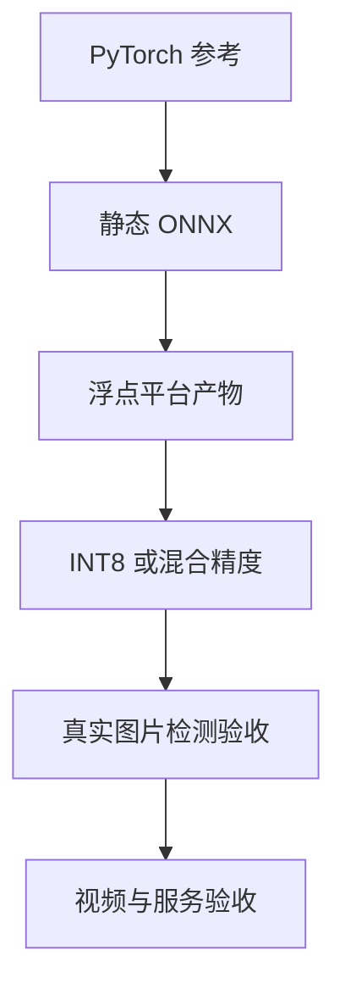

# YOLO 训练、导出与多平台部署

YOLO 的多平台部署应围绕同一份模型契约展开：数据、类别、前处理、输入输出与后处理先固定，再分别编译 BModel、OM、TensorRT 和 RKNN。本文给出完整流程的公共主线，平台专属参数按对应版本配置；所有示例使用静态 batch=1。

# 一、整理数据与训练配置

检查图片可完整解码、标注类别合法、框在边界内。由 XML 转 YOLO TXT 时从实际图片读取宽高。按来源或视频分组划分 train/val，防止相邻帧跨集合。

```yaml
path: /srv/datasets/detection
train: images/train
val: images/val
names:
  0: object
```

在已验证的 Ultralytics 环境训练：

```bash
yolo detect train model=yolo11s.pt data=data.yaml \
  imgsz=640 epochs=80 batch=16 device=0
```

这里的 batch 与 epoch 是示例，不是所有任务的推荐值。Ascend 上需先安装匹配的 PyTorch/`torch_npu` 和训练适配代码，验证单卡真实 batch 后再启用多卡；安装 CUDA wheel 不会让 NPU 环境自动可用。

# 二、固定导出接口

```bash
yolo export model=best.pt format=onnx imgsz=640 \
  batch=1 dynamic=False opset=17 simplify=False
```

首先检查原始 ONNX，再决定是否简化。归档各模型输出不完全相同，detect、pose 和包含 NMS 的图必须分别确认；不能凭 YOLO 名称硬编码输出 shape。

用固定图像比较 PyTorch 和 ONNX Runtime，保存已经完成前处理的输入张量与参考输出。YOLO 常用 Letterbox、RGB、`/255` 和 NCHW；训练增强不属于部署前处理。

# 三、编译平台产物

| 平台 | 工具 | 产物 | 需要明确 |
| --- | --- | --- | --- |
| Sophgo | TPU-MLIR | BModel | processor、前处理融合、校准 |
| Ascend | ATC | OM | soc_version、shape、AIPP |
| NVIDIA | TensorRT | plan | 实际 GPU、版本、profile |
| Rockchip | RKNN-Toolkit2 | RKNN | target_platform、量化与输入范围 |

先编译浮点路径，确认数值后再增加 INT8。TensorRT FP16 静态基线：

```bash
trtexec --onnx=model.onnx --saveEngine=model.plan --fp16
```

RKNN FP16 基线的核心 Python 入口：

```python
from rknn.api import RKNN

rknn = RKNN()
try:
    rknn.config(target_platform="rk3588")
    assert rknn.load_onnx(model="model.onnx") == 0
    assert rknn.build(do_quantization=False) == 0
    assert rknn.export_rknn("model.rknn") == 0
finally:
    rknn.release()
```

此例不融合图像前处理，输入需遵循原 ONNX 张量契约。若配置 mean/std 融合归一化，运行侧要相应改变输入，不能再次执行相同步骤。BModel 完整操作见同目录 Sophgo 教程；OM 需根据当前 ATC 帮助与芯片版本配置，不能猜测 soc 标识。

# 四、增加量化与检测头检查

校准集采用真实部署图像，并复用正式前处理。含 Q/DQ 的 ONNX 先按显式量化路线处理；普通浮点图再由后端校准。

单输出 YOLO 常把像素级 boxes 和 0–1 的 scores 拼接。若后端对整块输出使用同一量化尺度，类别分数可能被过大的范围吞没。此时需要检查输出 scale，必要时在图中分开两个分支，再同步修改后处理。

# 五、板端与整链验收



检测验收包括类别、阈值附近的分数、框匹配和数据集 AP。记录解码、前处理、模型、后处理的独立耗时，避免把纯引擎时间当成整帧延迟。

发布包保存模型、类别表和 manifest。manifest 至少说明版本、设备、I/O、前处理执行位置、量化配置、哈希、验收结果；模型文件与后处理必须作为同一版本更新。

# 六、参考资料

- [Ultralytics ONNX 导出](https://docs.ultralytics.com/integrations/onnx/)
- [TPU-MLIR](https://github.com/sophgo/tpu-mlir)
- [RKNN-Toolkit2](https://github.com/airockchip/rknn-toolkit2)

