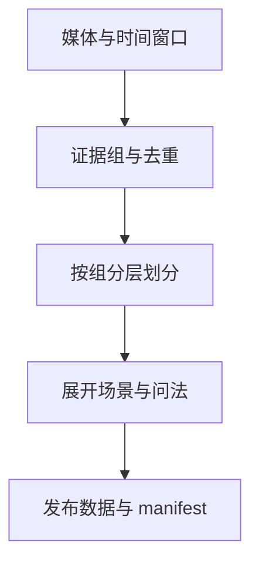

# VLM 数据构建中的一致性与划分

多模态训练的数据工程，从图片下载和字段清洗开始，最终要形成一份可追溯、可增量更新的数据版本。真正困难的部分是保持媒体、样本身份、标注和训练划分的一致性：修改 ID、移动文件或追加新导出包，都可能悄悄破坏它们之间的关系。

一份可以持续维护的数据集，需要区分原始证据、人工或模型标注、训练问法和发布版本。这样同一图片换了提示词，仍然能追溯到相同证据，也能避免相近样本进入不同数据划分。

# 一、证据身份与样本身份

| 对象 | 身份依据 | 适合保存的内容 |
| --- | --- | --- |
| 原始媒体 | 文件内容或稳定资源标识 | 哈希、格式、来源类型 |
| Evidence | 媒体与时间窗口 | 帧时间、窗口、模态 |
| 标注 | Evidence、任务定义与版本 | 结论、状态、人工修改 |
| 训练样本 | Evidence、场景与问法 | messages、images/videos |
| 发布版本 | 已确认样本与配置哈希 | manifest、划分与统计 |

连续编号适合展示，不适合作为去重键。重编号后身份变化，会让增量提取误把旧样本当新样本。内容哈希也无法识别不同编码的相同画面，因此需要结合语义相似性和视频时间重叠。

# 二、清洗与人工复核

清洗至少校验字段完整性、媒体可读性、标签合法性和路径可解析性。图片宽高应从文件读取，不能依赖可能为零的标注 XML。删除或排除样本时先更新状态，再由发布过程决定是否纳入，避免直接删除原始证据。

教师模型和复判模型一致，只能构成自动采纳条件之一。置信度不是经过校准的真实正确概率；低置信、不一致和难例需要进入人工复核。人工确认后的结果应优先于重跑模型，且保留修改历史。

# 三、按证据组划分

同一视频的相邻帧、同一窗口的不同问法、同一图片的增强版本应先组成证据组，再进行 train/val/test 划分。仅对 JSON 行随机采样，会让几乎相同的视觉信息跨集合泄漏。



划分还要考虑小场景。比例取整可能把少量样本的验证集切空，应明确最小数量和不能满足时的处理方式。随机种子、证据组键和划分参数共同进入缓存键，保证追加数据后能解释划分变化。

# 四、均衡与版本

正负均衡不是始终采用 1:1。训练分布与真实部署分布不同，会影响误报率和置信度解释。应先报告按场景、标签、模态的数量，再决定是否裁剪；只裁冗余部分，保留难例，并把发布裁剪与原始数据保存分开。

```json
{
  "schema_version": 1,
  "split_seed": 42,
  "group_key": "evidence_id",
  "counts": {"train": 8000, "val": 1000, "test": 1000},
  "preprocess_version": "v1",
  "label_version": "v2"
}
```

这是发布 manifest 的结构示例，数量不代表实际数据。版本还应包含内容哈希、排除原因及标注配置；单纯把目录命名为“最终版”无法支持回溯。

# 五、一些反思

数据集质量不只体现为清洗后的行数。可重复划分、可复核标注和可解释的分布变化，决定了之后能否判断模型改善来自算法还是数据变化。

增加问法能扩充训练行数，却不会自动增加独立视觉证据。评估应以证据组和场景为单位报告，避免把相同图片的多条提问当成多个独立成功案例。

# 六、参考资料

- [LLaMA-Factory 数据格式](https://github.com/hiyouga/LLaMA-Factory/blob/main/data/README.md)
- [scikit-learn 数据划分](https://scikit-learn.org/stable/modules/cross_validation.html)

