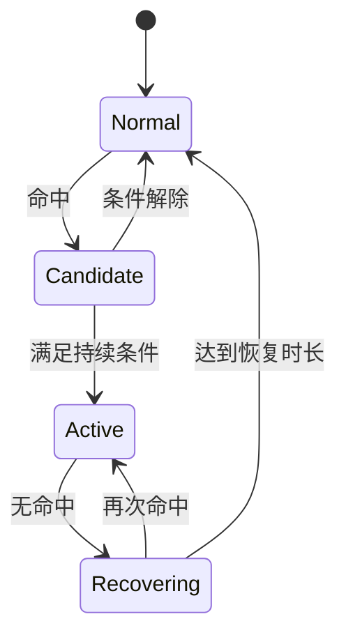

# CV 视频策略中的时序状态与报警

检测器回答当前帧有什么目标，视频策略则判断持续时间、目标身份与事件恢复。把二者混在一个回调里，容易出现帧率改变后阈值失效、目标交叉导致状态串联，以及多种时间戳互相覆盖的问题。

归档策略从连续帧、累计次数和中心点稳定性逐步演进。它们适合不同任务，不能把“连续三帧”当成固定的一秒，也不能只依赖坐标接近推断同一个目标。

# 一、明确时序判据

| 规则 | 适用意图 | 边界 |
| --- | --- | --- |
| 连续帧命中 | 短期稳定出现 | 受采样帧率影响 |
| 时间窗口累计 | 容忍短暂漏检 | 需定义窗口与最小覆盖 |
| 无命中恢复 | 取消已触发事件 | 独立恢复计时 |
| 轨迹静止 | 判断同一目标未移动 | 跟踪 ID 与抖动 |
| 事件冷却 | 减少重复通知 | 不应改变识别状态 |

基于时长的判断优先使用媒体时间或单调时钟。UTC 时间适合日志，不适合在系统校时后直接做持续时长差值。

# 二、状态与资源归属

每路视频、每条策略和必要时每个轨迹保存独立状态。报警发送时间、检测开始时间和恢复开始时间分别维护。MQTT 发送失败应记录传输状态，不应直接重置已经成立的视觉事件。

# 三、性能与坐标契约

ByteTrack 可用于稳定目标身份，仍需处理 ID 切换、遮挡和丢轨。归档 Eigen 实现相较另一跟踪实现有明显局部耗时改善，但跟踪阶段收益不能直接解释为整帧速度同幅提升。

坐标在原图、Letterbox 和归一化 ROI 之间转换，必须记录属于哪个空间。protobuf 与上游 SDK 版本变化还可能影响字段解释；模型框正确但上报坐标错误，应先核对序列化契约。

# 四、一些反思

时序规则的主要作用是让模型瞬时输出转成可管理事件。它能减少抖动，不能凭空提高检测器对不可见目标的识别能力。

状态机比散落的计数器更容易审阅。每个转移都有明确条件，异常、重连和空检测也有处理路径，之后增加场景时更容易保持一致。

# 五、参考资料

- [ByteTrack](https://github.com/ifzhang/ByteTrack)
- [Python 单调时钟](https://docs.python.org/3/library/time.html#time.monotonic)

