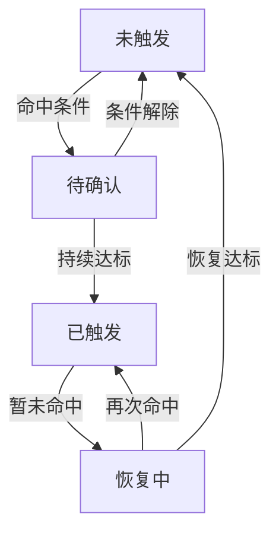

# CV 视频场景策略的触发与恢复

检测器回答当前帧有什么目标，场景策略则根据目标身份、空间关系和持续时间判断何时触发、何时恢复。把二者混在一个回调里，容易出现帧率改变后阈值失效、目标交叉导致状态串联，以及多种时间戳互相覆盖的问题。

在视频策略开发中，变化最多的往往不是模型接口，而是模型之后的判定：从持续时长改为命中次数、增加区域限制、容忍短暂漏检，或允许运行中调整参数。这些修改如果各自在回调里增加一个分支，后面很难再说清一次触发究竟由哪些条件共同决定。

更便于维护的组织方式是依次处理检测结果、空间与目标关系、时序确认、状态转移和后续动作。每层保留自己的输入与结果，修改一个条件时才不必重新解释整条链路。

连续帧命中、时间窗口累计和轨迹稳定性适合不同的判定条件。例如“连续三帧”随采样帧率变化，并不对应固定时长；坐标接近也不足以说明前后两帧属于同一个目标。

# 一、先把场景条件定义清楚

一条场景规则至少需要明确目标类别、区域条件、对象范围和时序判据。例如“区域内存在目标”和“同一个目标持续停留”都可以使用同一个检测模型，前者通常维护区域级状态，后者则需要目标关联。把区域内不同目标的时间累加到一起，会把前者误写成后者。

多个条件组合时，也要明确是否约束同一个对象。`存在 A 且存在 B` 只能说明画面中两类目标都出现；若规则要求 A 与 B 相邻、重叠或具有从属关系，就必须先形成匹配的对象对，再进行时序判断。不能拿某帧的 A 与很久以前缓存的 B 拼成当前条件。

| 编排步骤 | 要形成的结果 |
| --- | --- |
| 检测结果整理 | 统一类别、置信度、坐标与帧标识 |
| 空间与关系判断 | 哪个目标、区域或对象对满足条件 |
| 时序确认 | 条件是否满足约定的次数、时长或窗口覆盖 |
| 状态转移 | 本轮是继续保持、首次触发还是确认恢复 |
| 后续动作 | 消费状态变化，并记录各自执行结果 |

共享同一轮检测结果可以减少重复推理，但不同策略仍应保留各自的阈值与状态。两个规则需要互斥时，也应明确优先级，而不是让后执行的回调覆盖前一个回调的结果。

# 二、明确时序判据

| 规则 | 适用意图 | 边界 |
| --- | --- | --- |
| 连续帧命中 | 短期稳定出现 | 受采样帧率影响 |
| 时间窗口累计 | 容忍短暂漏检 | 需定义窗口与最小覆盖 |
| 无命中恢复 | 结束已触发状态 | 独立恢复计时 |
| 轨迹静止 | 判断同一目标未移动 | 跟踪 ID 与抖动 |
| 触发冷却 | 限制下游动作的重复执行 | 与策略状态分开维护 |

基于时长的判断优先使用媒体时间或单调时钟。UTC 时间适合日志，不适合在系统校时后直接做持续时长差值。

连续命中意味着一次有效未命中会打断累计；窗口内累计则允许中间出现未命中。若规则只写“累计三次”，却不规定窗口、复位和过期条件，几次相隔很久的偶发检测也可能最终触发。累计次数必须有明确的时间范围，不能无限增长。

从 10 FPS 抽样改为 2 FPS 后，三次命中覆盖的时间跨度会明显改变。若真正关心持续时间，应按时间判断；若需要最低观测次数，则可以同时约束时长与样本数。还要设置可接受的最大观测间隔，不能仅凭相隔几十秒的两次命中就认为中间一直成立。

媒体时间用于描述画面中的持续过程，单调时钟适合计算服务等待、重试与运行超时。离线视频加速回放时，用处理耗时判断画面中的停留时长会失真；实时链路积压时，消费旧帧也不能被当成当前画面的状态。两类时间应分别记录，重连后也不能直接延续已经归零的媒体 PTS。

## 未命中和没有观测是两种情况

空检测结果只有在本轮解码、推理和结果解析均有效时，才能作为“没有满足条件的目标”。解码失败、推理异常、帧被跳过、结果过期，都属于没有足够观测，不能直接送入无命中恢复逻辑。

可以把规则输入区分为命中、未命中和未知。未知时暂停相关判断或使状态过期，采用哪种方式取决于场景；但它不能悄悄变成未命中。尤其不能在断流后靠服务定时器自动证明“画面中的条件已解除”。

# 三、触发与恢复状态

一次命中先进入待确认状态，持续条件满足后才触发策略。已触发后出现短暂漏检，先进入恢复计时；恢复条件满足才回到未触发状态，期间再次命中则恢复为已触发。

状态按视频来源、策略实例和必要的轨迹 ID 分别保存。待确认开始时间、恢复开始时间和上次执行动作的时间独立维护，避免冷却计时覆盖持续条件的计时。

进入恢复中时，记录第一次有效未命中的时间。后续每次未命中只检查经过了多久，不要反复更新起点，否则恢复条件永远达不到。恢复期间再次命中，则清除本次恢复计时，保持当前事件；下一次未命中再重新计时。

冷却间隔只决定是否再次执行某个动作，不决定视觉条件是否仍然成立。首次触发、持续期间的周期动作与最终恢复应分别处理，否则很容易出现为了限制重复执行而把整个策略判断一起跳过的情况。

下面是假设确认时长为 2 秒、恢复时长为 3 秒的序列，所有观测有效，且间隔符合规则要求：

| 媒体时间 | 本轮结果 | 状态与处理 |
| --- | --- | --- |
| 0 秒 | 命中 | 待确认，记录起点 |
| 1 秒 | 命中 | 继续确认 |
| 2 秒 | 命中 | 首次触发 |
| 3 秒 | 未命中 | 进入恢复中，记录 3 秒 |
| 4 秒 | 命中 | 回到已触发，清除恢复起点 |
| 5 秒 | 未命中 | 重新从 5 秒计时 |
| 6、7 秒 | 未命中 | 继续恢复计时 |
| 8 秒 | 未命中 | 确认恢复，结束本次事件 |

这类序列比单独查看一帧更容易说明策略是否符合预期。一次持续事件最好有稳定的事件标识，直到确认恢复才结束，后续动作的重试继续引用该事件，而不是每次都生成一个新事件。

策略已经成立后，下游动作执行失败应记录为独立结果，后续按重试或降级逻辑处理。如果因此重置视觉状态，同一段持续满足条件的输入就会被反复当成新触发，时序规则也随下游处理速度发生变化。

# 四、状态隔离与配置变更

区域规则可以按视频来源与策略实例保存状态；目标规则还要加轨迹身份，对象关系规则则可能需要对象对。跟踪 ID 只在当前跟踪会话内有意义，视频重连或跟踪器重建后，即使数字相同，也不能默认继承之前的持续时间。

同一个状态键的更新需要按观测顺序串行进行。多个工作线程处理相邻帧时，先完成的未必是先采集的帧；若直接按完成顺序推进状态，较旧结果可能覆盖较新结果。可以记录会话标识和帧序号，对重复、过期或乱序结果执行明确的丢弃或重排策略。

轨迹消失后还要清理相应状态。短暂遮挡可保留有限时间等待关联，超时则结束或标记失效；不能无限保留，也不能把预测出来但没有新检测支持的轨迹，自动当成新的命中证据。对于已触发但失去观测的事件，应区分失效结束与有效观测下的正常恢复。

运行时配置也会改变既有状态的含义。修改目标类别、ROI 或对象关联方式后，旧累计通常不再适用；调整持续阈值是否立即作用于已有候选，则应事先约定。一轮判断使用同一份配置快照，并记录版本，避免空间判断用了旧 ROI、时序判断却用了新阈值。

# 五、性能与坐标契约

ByteTrack 可用于关联相邻帧的目标，仍需处理 ID 切换、遮挡和丢轨。跟踪 ID 变化时，需要明确旧状态何时失效、新状态是否重新计时。评估跟踪实现的性能时，也要分别统计检测、关联和策略计算，避免把局部耗时改善当成整条链路的同幅提升。

坐标在原图、Letterbox 和归一化 ROI 之间转换，必须记录属于哪个空间。跨模块传递时还需统一坐标范围与字段含义；检测框看起来正确、区域判断却不一致时，先检查两者是否在同一个坐标系中。

区域命中还需要明确采用框中心、底边中心还是面积交叠比例。这些定义无法互换：框中心在区域外，不代表目标与区域完全无交集；目标框与 ROI 的交叠面积占目标框的比例，也不是两者的 IoU。

Letterbox 引入的缩放和留边要先逆变换，再与原图 ROI 比较。若按常见等比例缩放表示，原图坐标可由 $x=(x'-p_x)/r$、$y=(y'-p_y)/r$ 恢复，其中 $r$ 是实际缩放比例，$p_x,p_y$ 是实际留边；实现时还要使用本次前处理真实采用的取整和 padding 参数。归一化坐标则应明确按哪一层图像的宽高换算。

仅有普通图像与归一化 ROI 时，不能把字段中的坐标当作经纬度使用。地理位置与图像像素之间需要额外的标定关系，改变字段名称或数值范围不能代替坐标变换。

阈值附近的检测框抖动，可以通过进入与退出条件分开、设置容忍带或结合时间确认处理。它们会改变触发延迟与边缘行为，需要作为策略参数验证，而不是在绘制时简单平滑一下框就认为判定也稳定了。

# 六、用序列回放验证编排

策略逻辑可以先使用已保存的检测结果与时间戳回放，无需每次重新运行模型。这样既容易复现，也能将模型输出变化与编排逻辑变化分开检查。

| 回放情形 | 重点观察 |
| --- | --- |
| 偶发命中、短暂漏检、再次命中 | 确认与恢复计时是否按定义复位 |
| 不同采样率与长时间缺帧 | 次数阈值是否改变含义，未知输入是否被误当成恢复 |
| 两路视频交错输入 | 相同策略或轨迹编号是否串用状态 |
| 目标交叉、遮挡、丢轨后重新出现 | 持续时间是否错误继承，旧状态是否按时清理 |
| 乱序结果、重复帧、重连后 PTS 归零 | 是否重复推进或跨会话累计 |
| ROI、类别和阈值在运行中更新 | 状态是否符合配置变更约定 |
| 后续动作失败或超时 | 视觉状态是否保持，重试是否重复创建事件 |

关键日志记录状态转移、转移原因、源帧时间、规则配置版本和事件标识即可；逐帧日志可按需开启。持续打印“仍然命中”既增加开销，也容易淹没真正解释触发和恢复的那几次变化。

这些回放用于核对时序与编排逻辑，现场效果仍要结合真实视频评估。模型的误检、漏检与跟踪错误不会因为状态机完整就自动消失，确认和恢复参数仍需根据实际序列调整。

# 七、一些反思

时序规则把瞬时检测结果转成持续的场景状态。触发前的确认时长用于减少偶发命中，触发后的恢复时长用于容忍短暂漏检，两者对应不同误差，不宜共用一个计数器或阈值。

状态机比散落的计数器更容易审阅。每个转移都有明确条件，异常、重连和空检测也有处理路径，之后增加场景时更容易保持一致。

场景编排的复用，主要在于统一观测、时间和状态生命周期。具体场景仍然需要自己的对象关系与时序判据；把它们全部压成一个通用计数器，反而会隐藏规则之间真正重要的差别。

# 八、参考资料

- [ByteTrack](https://github.com/ifzhang/ByteTrack)
- [Python 单调时钟](https://docs.python.org/3/library/time.html#time.monotonic)

