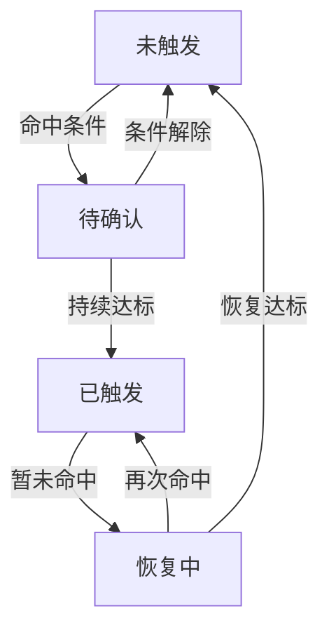

# CV 视频场景策略的触发与恢复

检测器回答当前帧有什么目标，场景策略则根据目标身份、空间关系和持续时间判断何时触发、何时恢复。把二者混在一个回调里，容易出现帧率改变后阈值失效、目标交叉导致状态串联，以及多种时间戳互相覆盖的问题。

连续帧命中、时间窗口累计和轨迹稳定性适合不同的判定条件。例如“连续三帧”随采样帧率变化，并不对应固定时长；坐标接近也不足以说明前后两帧属于同一个目标。

# 一、明确时序判据

| 规则 | 适用意图 | 边界 |
| --- | --- | --- |
| 连续帧命中 | 短期稳定出现 | 受采样帧率影响 |
| 时间窗口累计 | 容忍短暂漏检 | 需定义窗口与最小覆盖 |
| 无命中恢复 | 结束已触发状态 | 独立恢复计时 |
| 轨迹静止 | 判断同一目标未移动 | 跟踪 ID 与抖动 |
| 触发冷却 | 限制下游动作的重复执行 | 与策略状态分开维护 |

基于时长的判断优先使用媒体时间或单调时钟。UTC 时间适合日志，不适合在系统校时后直接做持续时长差值。

# 二、触发与恢复状态

一次命中先进入待确认状态，持续条件满足后才触发策略。已触发后出现短暂漏检，先进入恢复计时；恢复条件满足才回到未触发状态，期间再次命中则恢复为已触发。

状态按视频来源、策略实例和必要的轨迹 ID 分别保存。待确认开始时间、恢复开始时间和上次执行动作的时间独立维护，避免冷却计时覆盖持续条件的计时。

策略已经成立后，下游动作执行失败应记录为独立结果，后续按重试或降级逻辑处理。如果因此重置视觉状态，同一段持续满足条件的输入就会被反复当成新触发，时序规则也随下游处理速度发生变化。

# 三、性能与坐标契约

ByteTrack 可用于关联相邻帧的目标，仍需处理 ID 切换、遮挡和丢轨。跟踪 ID 变化时，需要明确旧状态何时失效、新状态是否重新计时。评估跟踪实现的性能时，也要分别统计检测、关联和策略计算，避免把局部耗时改善当成整条链路的同幅提升。

坐标在原图、Letterbox 和归一化 ROI 之间转换，必须记录属于哪个空间。跨模块传递时还需统一坐标范围与字段含义；检测框看起来正确、区域判断却不一致时，先检查两者是否在同一个坐标系中。

# 四、一些反思

时序规则把瞬时检测结果转成持续的场景状态。触发前的确认时长用于减少偶发命中，触发后的恢复时长用于容忍短暂漏检，两者对应不同误差，不宜共用一个计数器或阈值。

状态机比散落的计数器更容易审阅。每个转移都有明确条件，异常、重连和空检测也有处理路径，之后增加场景时更容易保持一致。

# 五、参考资料

- [ByteTrack](https://github.com/ifzhang/ByteTrack)
- [Python 单调时钟](https://docs.python.org/3/library/time.html#time.monotonic)

