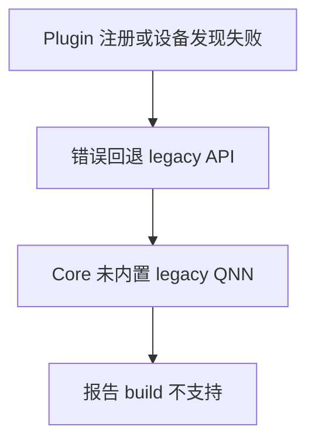

# Qualcomm ORT Plugin EP 的注册与错误归因

“QNN execution provider is not supported in this build”可能发生在适配层使用了错误 API 的阶段，尚未进入模型算子检查。归档环境中，独立 QNN Plugin EP 已安装、DSP 验证通过，却因注册与设备选择失败后回退 legacy API，产生了误导性的“不支持”错误。

独立探针使用 Plugin EP API 后可以创建 session 并运行模型，说明问题集中在应用适配层，而非模型或 HTP 硬件。

# 一、注册与设备选择

对应归档组合为 ORT Core 1.24.4、QNN Plugin EP 2.2.0、QAIRT 2.46.0。注册与枚举的关键入口如下，完整调用以所用版本头文件为准：

```cpp
Ort::Env env;
env.RegisterExecutionProviderLibrary(
    "qnn_runtime",
    ORT_TSTR("/opt/runtime/lib/libonnxruntime_providers_qnn.so"));
auto devices = env.GetEpDevices();
```

注册句柄名称与 provider 名称需要区分。ORT 通用 API 允许应用自行选择库注册名，设备枚举则按实际 EP 名选择；归档适配层使用 QNNExecutionProvider 统一二者以减少配置歧义，这不是所有 Plugin 都必须使用该注册名的限制。若没有 QNN 设备，应返回设备发现失败并保存原始 OrtStatus。

从 devices 中按实际 EP 名选择设备，再通过 SessionOptionsAppendExecutionProvider_V2 创建会话。Env 与库注册的生命周期需覆盖所有相关 Session；释放会话后才能注销库，否则设备与工厂对象可能仍被使用。

# 二、错误回退的后果



legacy API 只适用于具有对应内置 EP 的构建。它不能代替 Plugin 注册，也不能帮助诊断为什么 Plugin 设备没被发现。

原始错误应保留在第一失败点。若连续尝试多个 fallback，只返回最后一个异常，调用者就容易把适配层错误解释成模型兼容性。

# 三、用独立探针验收

| 层次 | 通过证据 |
| --- | --- |
| transport | DSP validator 或 FastRPC 探针 |
| 注册 | Plugin 状态与库路径 |
| 设备发现 | 枚举到 QNNExecutionProvider |
| session | 固定小模型创建成功 |
| 执行 | 输出正确、禁止静默 CPU 回退 |
| 集成 | 同环境在实际服务中通过 |

独立探针应尽量与业务服务使用同一份动态库及环境。Python 示例成功、C++ 应用失败时，还要核对两者到底加载了哪个 ORT Core。

# 四、诊断日志的最小集合

适配层至少输出 Core 完整版本、Plugin 实际路径、注册名、设备列表、选中设备、backend 路径以及 session 配置。每条日志对应一个明确阶段；错误时保留首个 OrtStatus，不以最后一次 fallback 的错误替代。

注册成功后的模型还需验证执行位置。关闭 CPU fallback 可以暴露不支持分区，但要配合 provider profile 确认真正的节点分配。只有设备名字出现在列表中，不足以证明业务图已在 HTP 执行。

公开诊断包采用固定小模型与合成输入，保留必要的 shape、dtype 和报错，去掉真实业务标签、路径与设备连接信息。这样既能复现 API 问题，也不会把完整业务工程变成故障报告的前提。

# 五、一些反思

fallback 是执行策略，也会改变故障解释。设备发现失败与模型算子不支持是不同阶段，应该使用不同错误类型，而非统一返回“不支持 QNN”。

“库已经加载”是薄弱证据；注册、发现、选择、执行才构成完整链路。适配层把这些阶段输出清楚，通常能减少大量模型侧的无效排查。

# 六、参考资料

- [ONNX Runtime Plugin EP 使用](https://onnxruntime.ai/docs/execution-providers/plugin-ep-libraries/usage.html)
- [QNN Plugin EP](https://github.com/onnxruntime/onnxruntime-qnn)

