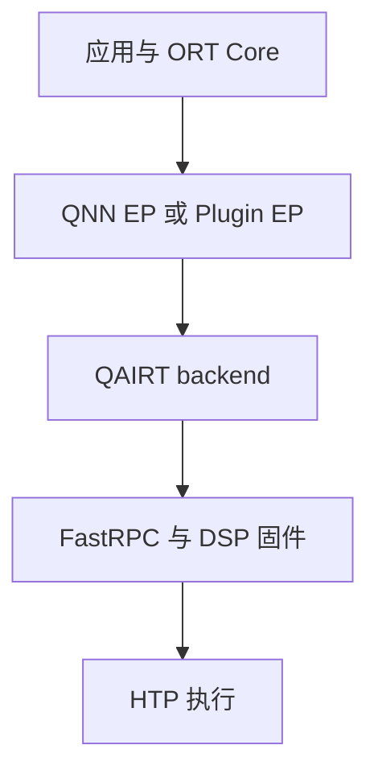

# Qualcomm QNN 的依赖分层与 ABI

QNN 推理通常涉及四层：ONNX Runtime Core、QNN Execution Provider、QAIRT backend，以及设备的 FastRPC、驱动和 DSP 固件。加载一个 provider 动态库，只覆盖其中一层；库存在也不意味着设备发现、图构建和模型执行都成功。

还需要区分内置 legacy QNN EP 与独立 Plugin EP。两者的安装和注册方式不同，部署说明应写明实际路径，避免混用 API。

# 一、依赖链



| 层次 | 典型材料 | 检查方式 |
| --- | --- | --- |
| ORT | libonnxruntime、头文件 | 完整版本、API |
| Plugin | providers_qnn 动态库 | 注册、设备枚举 |
| Backend | libQnnHtp、stub、skel | 加载日志、架构 |
| 系统 | libcdsprpc、listener、设备节点 | transport 探针 |

Linux ARM64 的 glibc 包与 Android 的 Bionic 包不可互换，即使二者都标记 aarch64。还需确认 GLIBC、GLIBCXX 需求与目标系统匹配。

# 二、模型格式的不同边界

| 格式 | 携带的信息 | 可移植限制 |
| --- | --- | --- |
| 普通 ONNX | 计算图与权重 | 后端算子与 shape 支持 |
| QDQ ONNX | 图及量化范围 | 位宽、dtype 与量化 kernel |
| EPContext ONNX | QNN context 引用或内嵌内容 | SoC、架构与运行库组合 |

EPContext 是 ONNX 容器中的专属执行产物，不能由任意 CPU ONNX Runtime 当通用图执行。context 需要在目标设备重新加载并测试，不能只验证生成阶段。

HTP 浮点与量化支持随 QAIRT/EP 版本变化。归档较新组合已经运行浮点图；早期文档中的“HTP 必须 QDQ”不能作为永远成立的结论。

# 三、加载路径

```bash
file ./lib/libonnxruntime.so
ldd ./lib/libonnxruntime_providers_qnn.so
ldd ./lib/libQnnHtp.so
```

`LD_LIBRARY_PATH` 解决宿主动态库查找，`ADSP_LIBRARY_PATH` 解决 DSP 侧搜索，两者作用不同。应用进程、容器或服务管理器应继承正确环境；交互 shell 成功不能证明 systemd 服务也相同。

缺少 skel、CDSP listener 或 transport 库时，先修依赖链。不能把设备加载错误解释为模型算子不支持。

# 四、Plugin EP 注册与错误定位

独立 QNN Plugin EP 需要先注册插件库，再枚举并选择设备，通过 V2 API 加入 Session。它与内置 legacy QNN EP 的注册方式不同，迁移已有适配层时需要一起修改设备选择和错误处理。

官方 QNN 示例使用 `QNNExecutionProvider` 注册并筛选设备。ORT 通用接口中的库注册名由应用指定，但库注册名与设备的 EP 名是两个概念；QNN 示例将二者保持一致。设备选择应核对实际枚举结果，不能直接沿用适配层内部的 `QNN`、`qcom` 等简称。

下面仅列出调用顺序，设备筛选与参数签名以对应版本头文件为准：

```text
RegisterExecutionProviderLibrary(name, plugin_path)
    → GetEpDevices()
    → 按实际 EP 名选择 QNN 设备
    → SessionOptionsAppendExecutionProvider_V2(devices, options)
    → 创建 Session 并运行最小模型
```

`Ort::Env` 和插件注册的生命周期需要覆盖相关 Session。注销库前，应先释放使用它的会话。

一次适配排查中，ORT Core 1.24.4、QNN Plugin EP 2.2.0 与 QAIRT 2.46.0 的独立探针能够创建 Session 并执行模型，应用却返回：

```text
QNN execution provider is not supported in this build
```

问题在于应用未选到 QNN 设备后，又回退调用了 legacy 的 `AppendExecutionProvider("QNN", ...)`。Core 没有内置这一 EP，最终错误便覆盖了前面的设备发现失败。这个提示只说明当前调用的 legacy 入口不可用，还没有进入模型算子检查。

设备列表为空时，应记录插件路径、完整 Core 版本、注册状态、枚举结果和 backend 配置，在这一阶段返回错误。旧 API 不能代替 Plugin EP 的注册；若确实需要兼容两种发行方式，应先明确识别部署包，再选择对应的初始化流程。

定位时可以先用 DSP transport 探针验证设备通信，再在同一进程环境中运行独立 ORT 小模型。Session 测试关闭 CPU fallback，并结合 profile 检查节点分配，避免把 CPU 执行误判为 HTP 成功。Python 示例成功而 C++ 应用失败时，还要核对二者实际加载的 Core、Plugin 和环境变量是否一致。

# 五、依赖打包与验收

发布包可以自带应用库、ORT、Plugin 和许可允许分发的 QAIRT 用户态；内核驱动、DSP 固件与设备权限由 BSP 负责。把两者分开清单，才能解释为何同一个 tar 包在两块板上表现不同。

| 验收阶段 | 失败含义 |
| --- | --- |
| ELF 加载 | 架构、ABI 或宿主依赖 |
| DSP transport | 固件、listener、权限或 skel |
| EP 注册 | Core/Plugin API 与库组合 |
| 图构建 | 算子、shape、dtype 与量化 |
| Run 数值 | 执行结果及任务精度 |

容器内应同时检查服务的真实环境与共享库路径。系统升级后，保留模型输入不变，先重跑小探针与 context 重加载，再恢复复杂服务。EPContext 能省去部分图构建开销，却不能省掉 backend 和设备侧运行依赖。

# 六、一些反思

依赖清单应包含“谁负责提供它”。开源 runtime、专有 SDK、BSP 驱动和模型产物分别升级，整体版本组合才决定可用性。

一个最小独立模型可以先证明 transport 与 EP 工作，再检查复杂图。把每层成功条件保存下来，之后更换模型时就无需重新猜测设备是否可用。

错误也应停留在实际失败的层次。插件注册、设备发现和模型图构建是不同阶段；连续回退后只返回最后一个异常，会把原本明确的初始化问题变成模糊的模型兼容性问题。

# 七、参考资料

- [QNN Execution Provider](https://onnxruntime.ai/docs/execution-providers/QNN-ExecutionProvider.html)
- [QNN Plugin EP](https://github.com/onnxruntime/onnxruntime-qnn)
- [ONNX Runtime Plugin EP 注册与设备选择](https://onnxruntime.ai/docs/execution-providers/plugin-ep-libraries/usage.html)
- [QNN Plugin EP 官方用法](https://github.com/onnxruntime/onnxruntime-qnn/blob/main/docs/execution_providers/QNN-ExecutionProvider.md#usage)
- [EPContext 设计](https://onnxruntime.ai/docs/execution-providers/EP-Context-Design.html)

