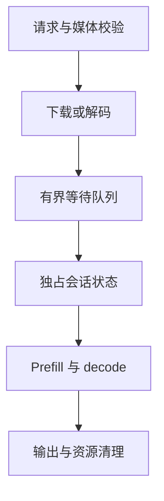

# Sophgo Qwen3-VL 服务中的状态与并发

把设备例程包成 HTTP 接口后，最先暴露的问题往往是状态所有权。Qwen3-VL 的一次生成包含视觉特征、位置编码、历史 K/V 和流式输出游标；如果多个请求共用一个可变实例，单请求正确并不能保证并发正确。

服务化应先说明哪一部分可共享、哪一部分必须由请求独占，再选择线程、进程和设备调度方式。增加线程池只是增加入口吞吐，无法自动建立模型状态隔离。

# 一、模型实例与会话状态

| 对象 | 生命周期 | 共享条件 |
| --- | --- | --- |
| 权重与只读配置 | 服务级 | 运行库明确支持共享 |
| device handle 与执行上下文 | 实例级 | 依据 SDK 的线程约束 |
| K/V、位置、生成游标 | 请求或会话级 | 并发请求不得互相覆盖 |
| 媒体文件与临时缓存 | 请求级 | 完成、失败和取消都需清理 |

线程局部实例可以隔离状态，但可能重复分配设备内存；单例节省内存，则需围绕完整推理生命周期串行化。锁只覆盖一次 kernel 调用通常不够，因为后续 token 仍依赖同一份历史状态。

```python
from contextlib import contextmanager
from threading import Lock

inference_lock = Lock()

@contextmanager
def model_session(model):
    with inference_lock:
        model.reset()
        try:
            yield model
        finally:
            model.reset()
```

这是单实例串行策略的关键结构。流式接口必须在生成器结束或关闭时退出上下文，不能在返回 HTTP 响应对象后就释放锁。

# 二、媒体输入与资源边界

远程 URL、Base64、本地文件和视频应在入口处归一为统一媒体对象，再交给模型 processor。下载、解码和临时文件管理属于 CPU 处理，可以与模型执行分离，但需限制图片像素、视频时长和解码数量。



错误处理应覆盖下载失败、processor 失败、设备执行失败和客户端断开。只有正常响应才清理文件，会在压力测试中逐渐积累磁盘或内存占用。

# 三、并发的代价

进程数增加会复制模型资源；线程数增加会增加对同一运行时的竞争；共享内存缓解进程间通信容量问题，却不能替代模型状态隔离。Python 扩展是否释放 GIL，也只决定 Python 线程能否同时进入 native 调用，不能证明设备执行支持重入。

更适合先测试一实例、一请求，再比较串行共享、线程局部实例和独立进程三种方案。观察吞吐、尾延迟、设备内存和取消后的恢复能力，结果通常比“设置多少 worker”更有意义。

# 四、一些反思

服务工程的核心是把例程中的隐式状态变成明确契约。缓存归谁所有、什么时候重置、失败后能否复用实例，这些问题比新增一个接口更影响长期稳定性。

并发目标也需要量化。若设备一次只能执行一个独占生成会话，入口线程主要用于隐藏媒体准备和网络等待。通过有界队列做背压，能够防止请求在设备前无限堆积，也能让超时具有可解释的含义。

# 五、参考资料

- [LLM-TPU](https://github.com/sophgo/LLM-TPU)
- [FastAPI 并发与异步说明](https://fastapi.tiangolo.com/async/)

