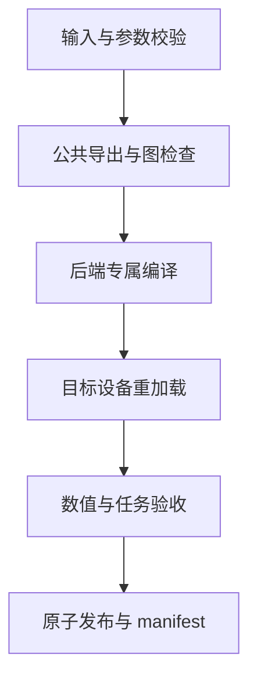

# 多平台模型编译与运行时的契约

BModel、OM、TensorRT 和 RKNN 可以使用相同输入模型，却有不同的 shape、量化、芯片和产物约束。统一转换工具的价值是统一可重复的流程和交付契约；后端差异仍需明确表达。

运行时也应围绕模型契约接入。一个产物是否能够加载，与前处理、输出解析和任务效果是否正确，是不同层次的验证。

# 一、公共参数与能力矩阵

| 参数 | 公共语义 | 后端差异 |
| --- | --- | --- |
| weight_path | 原始权重或 ONNX | 某些格式需先专属导出 |
| input_shape | 输入张量形状 | 动态支持按后端声明 |
| precision | 目标精度意图 | 名称相同不保证执行相同 |
| target | 编译目标 | 芯片、架构与工具链组合 |
| calibration | 校准数据 | 流程与前处理按后端 |
| output_name | 产物名称 | 实际格式与附属文件不同 |

不支持动态输入的后端，应在入口拒绝参数，而非接受后忽略。TensorRT 的实际 GPU 与兼容设置，和 RKNN 的 target_platform 也不是同一种目标选择机制。

# 二、编译流程与产物保护



临时目录与正式输出分开。验收完成后再更新产物；失败时保留诊断材料，避免覆盖旧模型后才发现新版本不可用。

manifest 至少包含哈希、I/O、前处理执行位置、目标、版本、精度和测量条件。只记录扩展名，无法判断两个同名文件是否可以互换。

# 三、运行时与控制面

服务发现、启动任务、日志与升级状态属于控制面；权重加载与推理属于执行面。接口返回“启动任务已提交”时，服务可能仍在加载，需要显式状态：

```text
STOPPED → STARTING → READY
             ↓
           FAILED
READY → STOPPING → STOPPED
```

镜像按“本地镜像→离线包→远程仓库”解析，最后核验 digest。权重采用明确路径或资源标识，已指定自定义模型时不能悄悄下载另一个同名模型。

# 四、一些反思

稳定的契约与变化的后端实现适合分开维护。把配置生成、执行和验收拆开，可以在升级工具链时只替换一层，同时保留相同输入与参考结果。

统一不要求所有平台拥有相同能力。明确报告“未验证”“不支持”和“已通过的组合”，比一个总返回成功的包装脚本更有用。

# 五、参考资料

- [ONNX IR](https://onnx.ai/onnx/repo-docs/IR.html)
- [ONNX Runtime EPContext](https://onnxruntime.ai/docs/execution-providers/EP-Context-Design.html)

