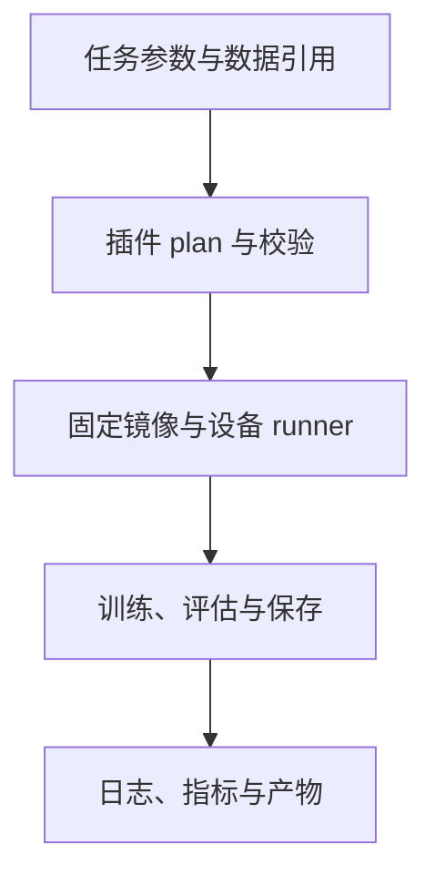

# 多平台训练的任务、数据与版本契约

把 GPU、Ascend 和 AMD 训练接进同一平台，需要统一任务表达与结果，而不是让 worker 了解每个工具链的所有细节。配置生成、设备运行、数据解析和产物打包应有清晰边界，才能同时支持平台调度和独立命令行运行。

后续多平台实测还表明，总训练时长的差异可能集中在验证或数据加载，而非训练 kernel。统一任务只有配合分项测量，才能成为可靠的跨平台对照。

# 一、任务与工具链分层

插件负责把公共请求转换成工具链配置；worker 负责资源与进程生命周期。独立入口和平台入口调用相同 plan 逻辑，可减少两套配置逐渐分叉。

任务目录保存配置快照、日志、状态与产物引用。模型和数据以只读路径引用，缓存按内容及参数哈希生成，避免每个任务复制整份媒体或重复分词。

# 二、版本与设备矩阵

| 维度 | 记录项 |
| --- | --- |
| 平台 | GPU、910B、AMD 等实际设备 |
| 基础栈 | 驱动、CUDA/CANN/ROCm |
| 框架 | torch、torch_npu、transformers |
| 工具链 | LLaMA-Factory、检测训练仓库 commit |
| 补丁 | 等价改写、后端守卫与可关闭开关 |
| 状态 | 未验证、冒烟通过、完整任务通过 |

镜像和插件正交：一个底座可支持多个任务插件，插件也可有多平台底座。浮动 latest 或 nightly 不足以表达经过验证的组合。

# 三、评测阶段也会成为瓶颈

归档 CV 三平台测试中，AMD 的训练迭代与 GPU 接近，总时长差异集中在未启用 AMP 的验证。验证加入 no_grad 与明确的混合精度后，10 epoch 总时长约从 260 多秒降到 120 多秒，而任务 AP 保持接近。

Ascend 的 DataLoader 曾在 fork 后继承线程锁而死锁，改用 forkserver 后恢复。需要同时检查启动方式、worker 数、缓存和第三方库线程；“worker 越多越快”并不成立。

AMP 验证与后端执行模式均应按 opt-in 配置，并进行 AP 回归。图模式遇到空张量或 capture 限制时保留 eager 基线，不把实验路径设为默认。

# 四、一些反思

统一平台最重要的产物是可解释的任务记录。用户能够重现配置、知道数据版本、确认实际执行设备，平台才具备长期维护价值。

跨平台优化要先分解时间。分词缓存、零复制 staging、验证 AMP 和算子改写分别作用于不同阶段，不能把整任务改善全部归为训练算力提升。

# 五、参考资料

- [LLaMA-Factory](https://github.com/hiyouga/LLaMA-Factory)
- [PyTorch 数据加载](https://docs.pytorch.org/docs/stable/data.html)
- [PyTorch AMP](https://docs.pytorch.org/docs/stable/amp.html)

