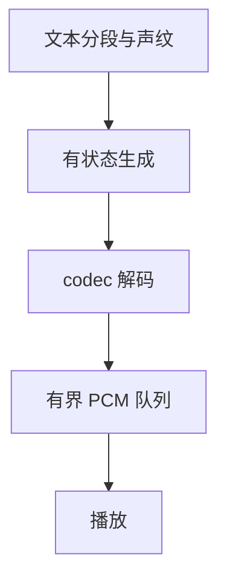

# 端侧多模态会话与流式语音的状态管理

移动端模型链路同时包含文本模板、语言模型 K/V、声纹条件、自回归音频码和 codec 状态。它们的生命周期不同：跨帧复用 codec 缓存，与跨句复用生成模型 K/V 并不是同一件事。

归档移植中，K/V 顺序错位曾造成音频异常，固定随机 seed 缓解跨次音色漂移，反复重建图与模型则增加首段延迟和卡顿。性能优化必须先建立状态与数值对齐。

# 一、状态分层

| 状态 | 复用边界 | 验证内容 |
| --- | --- | --- |
| 模型权重 | 引擎生命周期 | 加载与卸载 |
| 聊天 K/V | 同一会话 | 模板、token 与取消 |
| 声纹条件 | 同一说话人配置 | 编码与通道 |
| 自回归音频 K/V | 所定义的生成序列 | 输入重排与 reset |
| codec K/V | 连续音频帧 | 帧序与缓存对应 |
| 播放队列 | 当前朗读任务 | 背压、停止、残留 PCM |

不同 ONNX 子图之间 K/V 名称和顺序需要逐项对照参考实现。shape 匹配也可能把两个相同形状的缓存接反。

# 二、逐级 parity

先比较单帧输出，再比较跨帧连续结果，最后比较端到端音频。固定 seed、采样参数与参考声纹，对照 token、码本及 PCM；无法完成 parity 的缓存优化不应进入默认路径。

动态 shape 或 Metal 后端 abort 应缩小到具体图。CPU 路径可以作为数值基线，但 CPU 稳定不意味着已证明 GPU kernel 错误，还需相同输入的后端对照。

# 三、流式与取消

背压使生成速度与播放资源匹配。停止操作要同时取消生成、关闭 callback、清理播放队列，再允许新任务进入，避免旧 PCM 与新会话交错。

模型常驻与图复用减少重复初始化；分句时必须确认哪些状态需要重置。若每段重新包含参考声纹和完整输入序列，直接接续旧自回归 K/V 会重复或污染上下文。

# 四、一些反思

跨语言移植时应先保持参考行为，包括模板、thinking 开关、token 顺序与输出清理，再做平台性能优化。平台 API 看起来相似，隐式状态却可能不同。

端侧体验由首段延迟、播放连续性、取消响应与内存共同决定。单个 kernel 更快，无法补偿每帧重新构图或多个模型争用 CPU 带来的停顿。

# 五、参考资料

- [llama.cpp](https://github.com/ggml-org/llama.cpp)
- [ONNX Runtime 移动端](https://onnxruntime.ai/docs/tutorials/mobile/)

