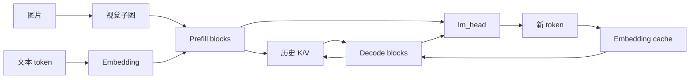

# Sophgo Qwen3-VL 子图导出与部署边界


Qwen3-VL 是同时处理文本、图像和视频的视觉语言模型。部署到算能设备时，除了语言模型权重，还需要视觉编码、位置编码、tokenizer/processor 和自回归生成状态共同配合。

TPU-MLIR 是面向算能 TPU 的模型编译工具链，负责将模型转换成目标设备可执行的 BModel。`llm_convert.py` 是其中针对受支持大模型的转换入口：读取 Hugging Face 格式的配置与权重，导出计算子图，调用后端编译，再合并模型和运行配置。它在 x86 编译环境中工作；最终推理由目标设备上的运行程序组织。

本文关注 BM1684X 与 SE8 的部署问题。该 SE8 环境由经以太网互联的独立 SoC 节点组成。需要同时回答两个问题：模型内部如何划分执行阶段，以及这些阶段能否映射到实际设备拓扑。理解前者有助于定位编译失败，但不会自动解决后者。

# 一、子图的执行阶段

CV 示例常走 ONNX → MLIR → BModel；Qwen3-VL 转换器则可以读取配置与权重，直接生成模型相关的 MLIR，并非必须先导出整模型 ONNX。

下面的算法省略采样头、DeepStack 专用操作和可选变体，突出导出、编译与打包的分工。


其中 $F$ 是源模型，$C$ 是模型及转换配置，$d$ 是目标设备，$\mathcal{G}$ 是子图集合。算法说明职责边界，不是某一版本转换器的逐行实现。

**Prefill 与 decode**

Prefill 一次处理 prompt 中的多个 token，生成这些位置的 K/V；decode 通常每次处理一个新 token，读取历史 K/V，再追加当前位置结果。因此两条路径即使共享一层权重，也不适合默认使用完全相同的输入形状、缓存布局和调度方式。

| 阶段 | 典型输入 | 状态行为 | 子图示例 |
| --- | --- | --- | --- |
| 视觉编码 | 图像 patch、视觉位置 | 生成视觉特征 | `vit` |
| Prefill | 一段 prompt 的隐藏状态 | 产生该段输入的 K/V | `block_i` |
| Decode | 新 token、历史 K/V | 读取历史，写入新 K/V | `block_cache_i` |



流程图省略视觉特征插入、DeepStack 注入和位置编码细节，仅表示执行职责。运行程序仍需决定子图执行顺序、张量传递和缓存生命周期。`model_tool --combine` 合并模型文件后，这些运行接口依然存在。

**子图与故障定位**

模型部署至少有四个不同的失败位置：源模型加载、子图导出、后端编译和设备运行。如果已经生成 `vit.mlir`，随后在其后端编译中失败，继续检查模型下载或反复重装 transformers 通常无法缩小问题。

相反，保存失败子图、固定转换参数，再用独立编译命令复现，才能把一个大模型问题缩成可分析的编译问题。这是子图拆分除了执行效率之外的重要价值。

# 二、SE8 多设备编译

已有实验对比单 device 与 `num_device=8`，结果如下。

| 配置 | 已记录结果 | 能确认的范围 |
| --- | --- | --- |
| 32B AWQ，单 device，W4F16，seq=8192 | 生成 BModel | 编译产物生成，未证明设备加载和推理成功 |
| 32B AWQ，`num_device=8` | 编译失败 | 该组合的多设备编译未跑通 |
| 8B，`num_device=8` | 同样失败 | 不能仅用 32B 的参数量解释 |
| 调整视觉尺寸、group size、core 数 | 测试记录仍为失败 | 缺少逐组日志，不能形成严格单变量归因 |

保留下来的失败任务涉及视觉子图：

```text
model_deploy.py --mlir vit.mlir --chip bm1684x --num_device 8 ...
  └─ tpuc-opt vit_bm1684x_f16_tpu.mlir ...
       ├─ 出现 position_ids / pos_idx 的 tpu.Cast 信息
       └─ Segmentation fault
```

日志支持将问题定位到该子图的后端编译任务，却不能直接证明某一条 Cast 是根因。整条命令包含多个 pass，必须通过更细日志、最小 IR 或调试栈确认崩溃位置。同样，段错误不等于已证明内存不足；这两类错误需要不同证据。

合理的后续实验是固定芯片、精度、输入上限及工具版本，先只改变 device 数；再独立改变视觉尺寸或编译并行度。否则多个参数一起变化，即使某次成功，也很难解释真正生效的条件。

# 三、容量与跨节点运行

**节点容量**

32B 参数按全部 4 bit 的理想情况粗算：

$$
M_{\mathrm{weights}}\approx32\times10^9\times\frac{4}{8}
=16\times10^9\ \mathrm{bytes}\approx14.9\ \mathrm{GiB}
$$

这只是权重的估算下界口径。真实峰值还包括量化元数据、保留高精度的模块、KV Cache 和工作区，视觉模块也可能采用不同精度。节点承载能力应比较实际可用内存与实测峰值，而不是模型文件大小或整台服务器的内存总量。

**跨节点执行**

独立 SoC 分别拥有自己的进程、内存与设备句柄。指定 `num_device=8` 不会自动建立跨主机通信，也不会将多个节点的内存合成一个连续设备空间。先确认运行程序实际看见哪些设备，再判断编译器生成的分片是否有可执行的通信与调度路径。

| 部署方式 | 单节点是否保存完整模型 | 主要解决的问题 | 需要的跨节点能力 |
| --- | --- | --- | --- |
| 多副本处理独立请求 | 是 | 提高请求吞吐 | 请求路由与结果返回 |
| 张量并行 | 否 | 分摊权重与层内计算 | 高频张量交换及同步 |
| 流水线并行 | 否 | 按阶段分摊容量与计算 | 阶段输出传递、流水线调度 |

副本并行不能解决单节点容量不足；模型分片能分摊容量，却需要转换器、运行时和互联共同支持。以太网是否划算，则取决于实际通信量、有效带宽、延迟和计算通信重叠，不能仅凭互联名称作绝对判断。本实验没有网络 benchmark，因此未验证跨节点并行的性能上限。

# 四、一些反思

这次方案没有形成可交付结果，原因分布在不同层次：多设备编译未跑通，单节点容量缺少完整实测，跨 SoC 运行路径也没有可用闭环。把它们统称为“模型太大”，会掩盖每一层需要补齐的条件。

更有效的部署评估顺序是：先验证节点拓扑与运行时设备接口，再确认各子图的编译支持范围，最后测量容量和性能。编译选项只能表达工具链支持的执行方式，不能补出缺失的跨节点运行能力。

另一点是保留失败实验的证据粒度。记录“8B 也失败”比只记录“32B 报错”更有价值，因为它缩小了仅由参数规模解释问题的空间；但缺少固定版本和单变量对照时，仍不应把一种可能原因写成已确认根因。

# 五、参考资料

- [TPU-MLIR](https://github.com/sophgo/tpu-mlir)
- [Qwen3-VL 转换器](https://github.com/sophgo/tpu-mlir/blob/master/python/llm/Qwen3VLConverter.py)
- [LLM 子图构建与编译流程](https://github.com/sophgo/tpu-mlir/blob/master/python/llm/LlmConverter.py)
- [LLM-TPU 运行例程](https://github.com/sophgo/LLM-TPU)
