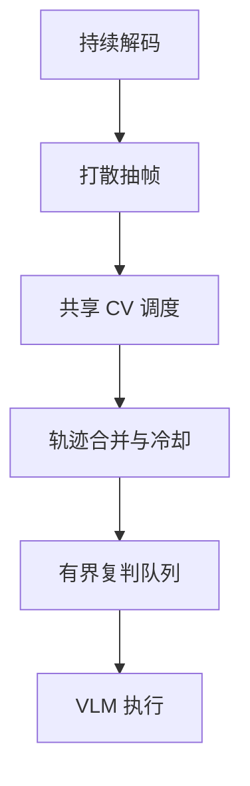

# NVIDIA 视频 AI 的容量与排队模型

多路视频容量至少包含三个不同预算：持续解码、抽帧 CV 推理和触发后的 VLM 复判。视频能解码，不代表每帧都能跑模型；CV 平均负载不高，也不代表事件突发时队列不会积压。

原始选型材料中的具体 SKU 路数属于规划估计，缺少目标设备完整压测，因此这里保留计算方法，不把估计包装成实测容量。

# 一、把流数转成任务率

设视频流数为 $N$、每路抽帧周期为 $T$ 秒、一帧平均运行独立模型数为 $M$：

$$
R_{\mathrm{CV}}=\frac{NM}{T}
$$

多个场景复用同一个模型结果时，$M$ 仍为 1；只有不同权重的独立前向才增加扇出。把所有已安装模型数代入会高估负载。

| 示例 | CV 任务率 |
| --- | ---: |
| 100 路、1 秒一帧、共享一个模型 | 100 次/s |
| 相同流数、2 秒一帧 | 50 次/s |
| 1 秒一帧、平均两个模型 | 200 次/s |

这些是算术示例，不是任何 GPU 的承载承诺。

# 二、复判入口与并发

设命中比例为 $h$，跟踪与冷却后保留比例为 $d$：

$$
\lambda_{\mathrm{VLM}}=R_{\mathrm{CV}}hd
$$

稳定条件取决于实测服务率和负载分布。Little 定律用平均停留时间描述平均在途量：

$$
L=\lambda W
$$

以 p95 延迟估算初始并发可作为保守规划，但不等于精确排队公式。提高并发会改变每请求延迟，必须重新测量整条曲线。事件突发、长图片处理和共享 GPU 竞争，都可能使平均值失去保护作用。

# 三、共享资源与背压

分别限制接入流数、CV 任务率、在途 batch、VLM 活跃请求和最大排队时长。100 路不应都在同一毫秒抽帧，也不应各自创建独立模型上下文。

压测使用实际编码、分辨率、模型、后处理和 NUMA 拓扑。纯解码与纯引擎成绩只能作为分项基线，最终容量通过混合负载与持续运行确定。

# 四、测量突发与降级

压测既要稳定平均到达，也要模拟多路同时命中的突发。记录队列长度、等待 p95、超时率、CV 尾延迟和 VLM 的实际服务率。若积压持续增长，即便 GPU 平均利用率看起来不满，也可能已经受到某个串行阶段限制。

任务过期后继续执行会浪费计算。可以按事件优先级、截止时间和同轨迹合并降载，但要保存降级标记，不能把未执行复判写成模型否定。

选择硬件前先建立单卡混合负载曲线，再按 NUMA 与扩容拓扑验证双卡。线性复制单卡容量忽略了 CPU 解码调度、内存带宽和跨 socket 传输，需要实测确认。

# 五、一些反思

容量规划的关键是测到稳定区间和失效边界。规划估计适合安排 PoC，发布容量需要真实持续负载证明。

对共享 GPU，入口控制通常比无上限增加并发更有效。去重和背压降低无效计算，也让超时与降级策略可以明确解释。

# 六、参考资料

- [NVIDIA Video Codec SDK](https://developer.nvidia.com/video-codec-sdk)
- [NVIDIA NVDEC 文档](https://docs.nvidia.com/video-technologies/video-codec-sdk/)

