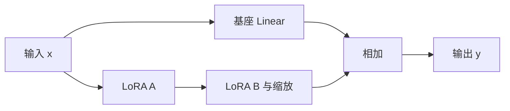
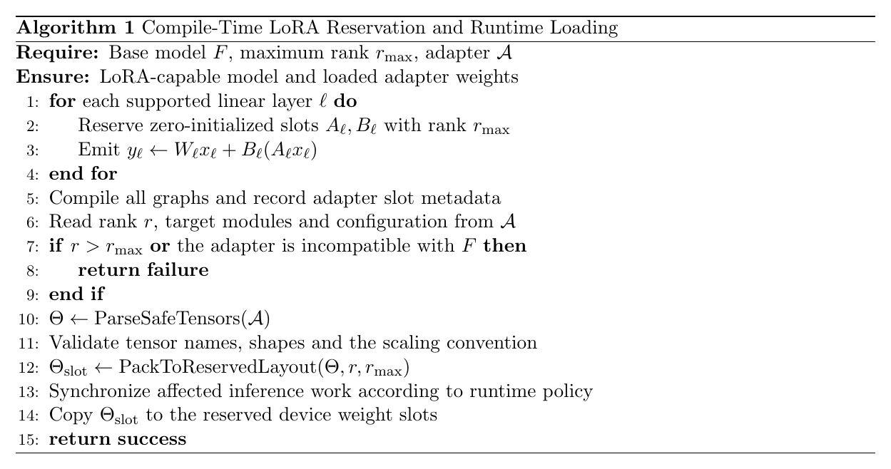

# Sophgo LoRA 编译预留与动态加载


LoRA 用低秩增量适配基座模型，训练产物通常是 adapter 配置和权重，而不是一套完整的新模型。端侧部署需要解决的具体问题是：这些增量参数怎样进入已编译的计算图，以及切换 adapter 时怎样保持结果正确。

Sophon 的 Qwen3-VL 配套 demo 提供加载和清除 LoRA 的接口。其前提是编译时预留低秩分支和权重位置；普通 BModel 不会因为多传一个 adapter 路径，就自动获得 LoRA 能力。

以下流程针对 BM1688、Qwen3-VL-2B、BF16、最大 rank 32 的示例组合。其他芯片或量化格式需按实际工具链支持范围验证，加载时延与任务效果仍需在目标设备上测量。

# 一、计算图与参数

忽略 bias，用列向量约定描述 Linear：

$$
y=Wx+\frac{\alpha}{r}BAx
$$

其中 $W\in\mathbb{R}^{N\times K}$，$A\in\mathbb{R}^{r\times K}$，$B\in\mathbb{R}^{N\times r}$，$r$ 是 adapter 的实际 rank。部署图保留基座计算、两次低秩矩阵计算和一次相加；训练侧的 $\alpha/r$ 缩放应由转换与加载路径按实际格式处理。



编译时 LoRA 权重初始化为零，未加载 adapter 时分支贡献为零。换 adapter 改变的是已有槽位中的参数，图结构仍然固定；零贡献不意味着运行时必然跳过该分支。

下面的算法展示编译预留与运行加载的分工。实际实现还要处理转置、rank 填充、缩放和运行时同步；算法中的 $B_\ell$ 表示已按加载约定处理缩放的有效参数。



**两种部署方式**

将 LoRA 先合并为 $W+\Delta W$，再编译完整模型，可以把低秩分支折回基座计算；独立分支则保留 adapter 切换接口，同时带来额外计算、预留空间和状态管理。

| 方式 | 部署图 | 更适合的情况 | 需要承担的成本 |
| --- | --- | --- | --- |
| 合并 adapter 后编译 | 基座权重已包含增量 | 固定一个版本长期运行 | 更换 adapter 通常需要重新生成模型 |
| 编译预留 LoRA 分支 | 基座与增量独立计算 | 同一基座需要切换 adapter | 分支计算、权重加载与并发协调 |

是否值得采用动态分支，应由切换频率、模型生成成本和实际推理开销决定，而不是仅凭“可以热加载”判断。

# 二、编译 BModel

**预留最大 rank**

在模型编译环境中加入 `--lora_max_rank 32`：

```bash
llm_convert.py \
  -m /workspace/Qwen3-VL-2B-Instruct \
  -s 2048 \
  --max_input_length 1024 \
  --quantize bf16 \
  --lora_max_rank 32 \
  -c bm1688 \
  --out_dir qwen3vl_2b_with_lora \
  --max_pixels 768,768
```

最大 rank 是预留容量，实际 adapter rank 不应超过它。rank 合法仍不够，还需匹配基座、层名、target modules、tensor shape 和加载器支持范围。例如所核读的 Linear LoRA 构图路径对带 bias 的情况有明确限制，不能由此推断支持所有 PEFT 变体。

最大 rank 与实际 rank 还有一个容易混淆的区别：空间按 $r_{\max}$ 预留，缩放仍应保持训练 adapter 的 $\alpha/r$ 语义。例如实际 rank 为 8、预留 rank 为 32，若错误地用 32 替代缩放分母，增量幅度会变成原来的四分之一。这是数学上的检查点，不是已确认该 demo 存在此错误。

**检查权重槽位**

```bash
model_tool --weight YOUR_LORA_MODEL.bmodel
```

应看到类似名称：

```text
lora.32.0.model.language_model.layers.27.self_attn.q_proj.lora_A.weight
lora.32.0.model.language_model.layers.27.self_attn.q_proj.lora_B.weight
```

这能确认对应分支和槽位已进入模型，但还不能证明某个 adapter 已正确加载。接下来仍需要验证 tensor 映射、实际输出与切换结果。

# 三、加载与切换

**文件与运行程序**

```text
qwen3vl_2b_lora/
├── adapter_config.json
└── adapter_model.safetensors
```

使用带 LoRA 功能的 Qwen3-VL demo，确认 CLI 支持 `--lora`。运行类提供的关键接口为：

```cpp
bool lora_load(const std::string &lora_dir);
void lora_clear();
```

在匹配 SDK、运行库和目标架构的构建环境中，进入配套 demo 目录：

```bash
mkdir -p build
cd build
cmake ..
make
mv pipeline ..
cd ..
```

**启动与交互测试**

将模型、config 与 adapter 路径替换为实际产物：

```bash
./pipeline \
  -m ../../YOUR_LORA_MODEL.bmodel \
  -c ../config/ \
  --lora qwen3vl_2b_lora
```

交互测试可使用：

```text
lora_clear
tell me a story

lora_load
tell me a story
```

这里加载的是程序配置的 adapter 目录，交互命令以配套 demo 版本为准。每组对照都从新的会话状态开始；不能把上一组的对话历史混入下一组测试。

# 四、权重与会话验收

固定输入和生成参数，至少比较以下状态：

| 状态 | 检查内容 |
| --- | --- |
| 基座、空会话 | 建立参考输出 |
| adapter 已加载、空会话 | 确认权重匹配和预期任务效果 |
| adapter 清除、空会话 | 确定性条件下检查是否恢复基座结果 |

文本回答适合功能冒烟，数值一致性可以通过 logits 或 top-k 检查。随机采样导致的两次回答不同，不能单独证明加载成功。

这里还有两类状态容易漏掉。首先，旧 adapter 生成的 KV Cache 不会仅因为清除权重就自动变成基座模型的状态，应确认 demo 是否重置缓存或另起会话。其次，多个请求若共享同一组设备权重槽位，加载新 adapter 会影响这些请求；同步、实例隔离或 adapter 调度需要由运行时保证。

对较小 rank 的 adapter，还要确认未使用的预留区域如何处理，以及旧权重是否可能残留。加载失败时是否保持原模型状态，也必须通过实际接口行为确认。最后另行测量加载时延、额外内存和推理速度，才有完整的部署评估。

# 五、一些反思

LoRA 参数小，并不意味着加载过程只是一份文件的替换。编译图、权重槽位、缩放约定、缓存和并发请求都需要保持一致，结果才是可解释的。

最大 rank 管空间，实际 rank 管 adapter 的数学语义；权重检查证明槽位存在，输出对照证明加载有效；清除权重恢复了参数，却还需要确认会话状态恢复。这几个层次分开验收，比只观察两次回答是否不同更可靠。

动态分支的价值在于减少模型切换成本。只有同时量化它带来的推理开销和状态管理成本，才能判断它相对“合并后重新编译”是否值得采用。

# 六、参考资料

- [LoRA 论文](https://arxiv.org/abs/2106.09685)
- [TPU-MLIR LLM 构图实现](https://github.com/sophgo/tpu-mlir/blob/master/python/llm/LlmConverter.py)
- [LLM-TPU](https://github.com/sophgo/LLM-TPU)
