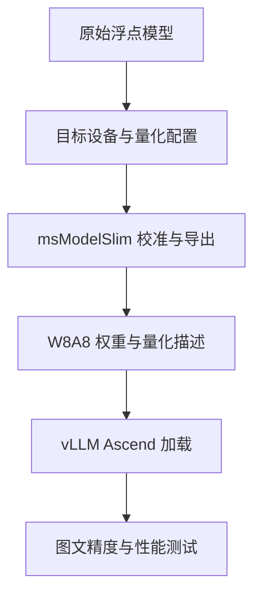

# Ascend 多模态模型的量化与工具链边界

昇腾多模态模型的量化方案需要从目标设备和推理框架出发。910B 上可用的 W8A8 模型，迁移到 310P 时可能需要重新量化并改用 FP16；310B 又有不同的算子和框架限制。下载一个压缩权重包，只解决了模型存储问题，后续还需要设备能执行对应计算、框架能正确加载各个模块。

本文以 Qwen3-VL 为例，整理 910B 上的 msModelSlim W8A8 路径，以及迁移到推理设备时需要重新确认的条件。AWQ、FP8、W8A8 分别涉及算法、数值格式或位宽组合，实际部署还要看权重组织方式和后端内核。

# 一、先区分设备与计算类型

| 设备 | 浮点与量化方面的关键约束 | 部署选择 |
| --- | --- | --- |
| 910B / Atlas A2 | 支持相应的 FP16、BF16 和 INT8 计算；普通 FP8 权重不能按 GPU 的原生 FP8 路径执行 | Qwen3-VL 优先使用已适配的浮点模型或 msModelSlim W8A8 模型 |
| 310P / Atlas 300I Duo | 多模态部署使用 FP16 路径；量化内核、权重布局和模型支持范围与 910B 不同 | 先建立 FP16 基线，再选择对应型号、框架版本支持的量化方案 |
| 310B / Atlas 200I A2 等 | ATB 的矩阵乘、量化矩阵乘有 BF16 输入输出限制；vLLM Ascend 官方 FAQ 列为未支持设备 | 选择明确适配 310B 的推理工具链，按算子支持范围配置 FP16 与 INT8 |

310B 和 310P 是不同设备，型号中的“A2”也不能单独作为能力判断依据：Atlas 200I A2 与 Atlas 800I A2 对应的芯片和软件支持范围不同。安装包、算子包和量化模型都要对应具体产品。

BF16 与 FP16 同为 16 位浮点，但数值范围不同。把 BF16 模型迁移到 FP16 时，除了设置运行 dtype，还需要检查权重和中间计算是否溢出。改 `config.json` 的标记不会重新编码量化权重，也不会补齐缺失的设备算子。

# 二、910B 上的 W8A8 路径

在这组 Qwen3-VL 部署中，可用的量化方案是从浮点模型出发，用 msModelSlim 生成 W8A8 权重，再由 vLLM Ascend 的 Ascend 量化后端加载。W8A8 表示被量化部分的权重与激活采用 INT8，视觉编码器、投影层和其他保留浮点的模块仍需逐项确认。

模型目录应同时包含量化权重、`quant_model_description.json`、模型配置、tokenizer 和 processor。msModelSlim 产物使用 `--quantization ascend` 进入对应加载路径；静态和动态 W8A8 的 scale 粒度、计算方式不同，也需要与运行时实现一致。

vLLM Ascend 不支持 `awq` 量化后端，直接指定 `--quantization awq` 会被 NPU 平台检查拒绝。已有 AWQ 权重不能通过修改启动参数变成 msModelSlim W8A8；两者的 scale、zero point 和权重打包方式不同。对于本文的 Qwen3-VL 部署，应从原始浮点模型重新生成已适配的 W8A8 产物。

compressed-tensors 是权重与量化配置的组织格式。vLLM Ascend 对其中部分量化方案有适配，但这不等于支持 AWQ 后端。改配置中的量化名称，或者消除命令行与模型配置的冲突，都不会补出缺失的执行内核。

vLLM Ascend 的量化支持已经扩展到多种方案，官方 Qwen3 Dense 教程包含 W8A8、W4A8 和 W4A4。这些位宽组合使用各自适配的量化产物与内核，其中的 4 位权重支持也不能当作 AWQ 支持。纯文本模型、MoE 专家层与多模态模型的适配范围需要分别查阅。

# 三、FP8 加载与计算的区别

910B 上不能直接套用 GPU 的原生 FP8 推理路径。需要分清三个问题：文件中的权重是否以 FP8 存储，加载后是否仍保持 FP8，以及矩阵乘是否由 FP8 内核执行。

vLLM Ascend 当前 main 分支的量化指南增加了 block-wise FP8 checkpoint 加载：950PR/950DT 使用原生 FP8 路径，其他代际则在加载时还原到模型 dtype，使用 BF16 矩阵乘，权重内存约为 FP8 存储的两倍。这是特定新版的加载与还原能力，使用旧版镜像时需要检查是否包含该实现。

因此，评估 FP8 包能否节省设备内存，应查看实际加载后的 dtype 和内存占用。如果运行时将权重展开为 BF16，下载体积虽然缩小了，设备上的权重占用仍接近 BF16 模型。量化文件较小与低精度计算加速是两项不同收益。

# 四、迁移到 310P 与 310B

310P 上的 Qwen3-VL 调试曾遇到 BF16 和 W8A8 动态量化不兼容，换用非量化模型、采用 FP16 并调整并行与上下文配置后，模型引擎才成功启动。910B 的量化产物在这里需要重新检查，尤其是浮点模块的 dtype、量化 scale 类型以及矩阵布局。

官方 Qwen3 Dense 教程为 Atlas 推理产品单列了 W8A8SC-310 权重，并使用 `--dtype float16`。这说明量化产物本身就可能面向特定设备路径；该纯文本示例也不能直接充当 Qwen3-VL 的支持证明。

310B 则首先受框架支持限制。vLLM Ascend 官方 FAQ 将 Atlas 200I A2（310B）列为未支持设备。即使另一个工具可以为 310B 生成 INT8 模型，也需要用适配它的运行时执行，不能沿用 910B 的 vLLM 启动方式。

华为 ATB 文档明确列出 Atlas 200I/500 A2 的普通矩阵乘和量化矩阵乘不支持 BF16 输入输出，Softmax 也有仅支持 FP16 的限制。部署时应按 FP16 基线和目标 INT8 算子规划，逐项检查模型所需算子。

# 五、软件环境与问题定位

| 阶段 | 现象 | 优先检查 |
| --- | --- | --- |
| 权重加载 | 视觉模块 `KeyError` | 权重覆盖、模块名、量化加载器 |
| 格式解析 | 量化配置冲突 | 模型配置与命令行所选后端 |
| 编译 | `cstdint` 缺失或 CANN API 未声明 | 编译器、头文件与二进制版本 |
| 算子执行 | BF16 不支持或量化算子报错 | 目标设备、dtype、量化方案与内核支持 |
| 服务运行 | Triton 资源超限或 EngineCore 退出 | 首个异常、shape、设备内存与并发负载 |

msModelSlim 的 W8A8 量化曾在容器中通过，而 conda 环境处理视觉编码器 Conv3D 时出现 `cstdint` 缺失。此时应先补齐编译依赖。运行阶段的 CANN API 未声明，则需要核对头文件、动态库和服务版本，避免环境里同时引用不同版本的组件。

部署矩阵应记录“模型修订＋量化格式＋芯片＋CANN＋服务版本＋运行参数”，并把加载成功、短请求通过和持续运行通过分开标记。

# 六、一些反思

量化方案更适合从运行时支持的内核往回选择，再决定如何生成权重。先下载体积最小的模型、再尝试调整参数，容易在不支持的格式上花费大量时间。

多模态模型尤其需要按模块检查。语言部分的权重已经压缩，视觉编码器、投影层和 KV cache 仍可能占用大量内存；迁移到不支持 BF16 路径的设备时，这些保留浮点的部分还会决定整个模型能否运行。

浮点基线可以帮助区分模型架构适配与量化执行问题。先在目标设备支持的 dtype 下确认图文输出正常，再引入量化，并比较权重加载、算子执行、精度和实际内存占用的变化。

# 七、参考资料

- [vLLM Ascend](https://github.com/vllm-project/vllm-ascend)
- [AWQ 量化后端在 NPU 上不受支持的报错记录](https://github.com/vllm-project/vllm-ascend/issues/6800)
- [msModelSlim](https://github.com/Ascend/msmodelslim)
- [vLLM Ascend 硬件支持 FAQ](https://github.com/vllm-project/vllm-ascend/blob/main/docs/source/faqs.md)
- [vLLM Ascend 量化指南（main 分支）](https://docs.vllm.ai/projects/ascend/en/main/user_guide/feature_guide/quantization.html)
- [Qwen3 Dense 量化与 Atlas 推理设备配置（v0.23.0rc1）](https://docs.vllm.ai/projects/ascend/en/v0.23.0rc1/tutorials/models/Qwen3-Dense.html)
- [CANN 8.2.RC1.alpha001 ATB 接口与硬件约束](https://www.hiascend.com/doc_center/source/zh/CANNCommunityEdition/82RC1alpha001/API/ascendtbapi/CANN%E7%A4%BE%E5%8C%BA%E7%89%88%208.2.RC1.alpha001%20%20Ascend%20Transformer%20Boost%20%E5%8A%A0%E9%80%9F%E5%BA%93%E6%8E%A5%E5%8F%A3%2001.pdf)

