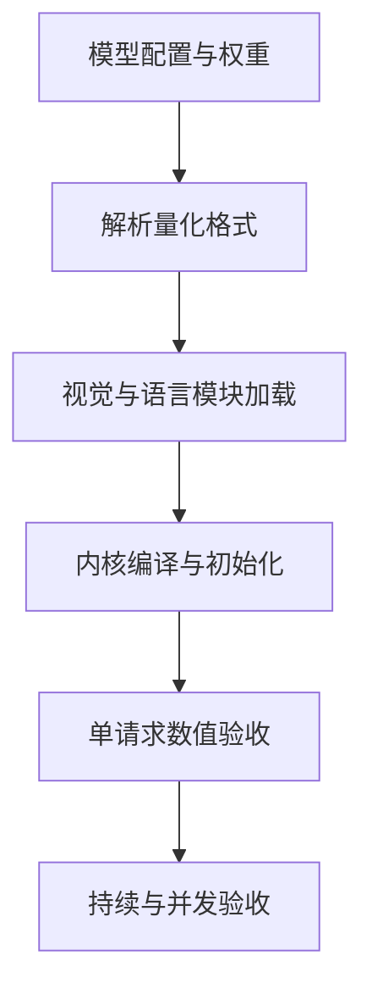

# Ascend 多模态模型的量化与工具链边界

在 Ascend 上加载多模态量化模型，需要同时匹配模型结构、权重格式和运行时实现。AWQ 或 FP8 只是量化方式的名字，不能据此推断视觉塔、投影层和语言模型都已经被当前后端支持。

Qwen3-VL 的部署记录中出现过视觉权重缺失、量化配置冲突、CANN API 编译失败和高并发 EngineCore 退出。它们分别发生在模型加载、格式解析、内核编译和服务运行阶段，应当按阶段定位。

# 一、量化格式与覆盖范围

归档环境中的 Qwen3-VL-32B AWQ/FP8 包曾在视觉权重加载时出现 `KeyError`，全精度路径可以运行。该对照把问题缩小到量化包与加载器的契约，但不足以断言整个后端永远不支持该格式。

另外，文件名包含 AWQ 不代表 `quantization_config` 一定使用 AWQ 标识。模型可能采用 compressed-tensors 包装；命令行强制指定另一格式，会在读取权重前就失败。

# 二、软件环境与模型能力

| 现象 | 优先检查 | 无法据此断言 |
| --- | --- | --- |
| 视觉权重 KeyError | 模块名、权重覆盖、加载器实现 | 芯片不能运行视觉模型 |
| `cstdint` 缺失 | 编译器、头文件、容器与 conda 差异 | 量化算法本身错误 |
| CANN API 未声明 | 头文件与二进制版本组合 | 模型图数学不成立 |
| Triton 超资源限制 | 当前 shape、芯片资源与 kernel | 降低并发一定解决 |
| EngineCore 退出 | 首个异常、共享内存、设备内存 | 客户端 500 就是 OOM |

msmodelslim 的 W8A8 路径曾在容器中通过，而相同任务在 conda 环境出现编译依赖缺失。环境对照比继续调整量化参数更直接；应保存编译命令和工具链版本，而不是仅记录“换容器好了”。

# 三、芯片与新架构

910B 上验证的启动方式不能直接复制到 310P。芯片能力、算子实现、dtype 和服务框架支持范围都可能不同。Qwen3.5 的混合线性注意力还引入了新的缓存与 kernel 路径，关闭不支持的 prefix cache 可以绕过初始化限制，但不能证明长上下文和高并发已可用。

部署矩阵应记录“模型修订＋量化格式＋芯片＋CANN＋服务版本＋运行参数”，并把加载成功、短请求通过和持续运行通过分开标记。

# 四、一些反思

跨平台部署中，量化文件的可移植性经常被高估。压缩权重只是表示层，真正决定是否可用的是目标后端如何解释这些权重、哪些模块保持浮点以及哪些内核负责计算。

全精度基线很有价值：它能帮助区分模型架构适配与量化执行问题。若全精度也失败，继续搜索量化参数通常没有意义；若只有量化失败，应该沿格式和内核路径查差异。

# 五、参考资料

- [vLLM Ascend](https://github.com/vllm-project/vllm-ascend)
- [msModelSlim](https://github.com/Ascend/msmodelslim)

