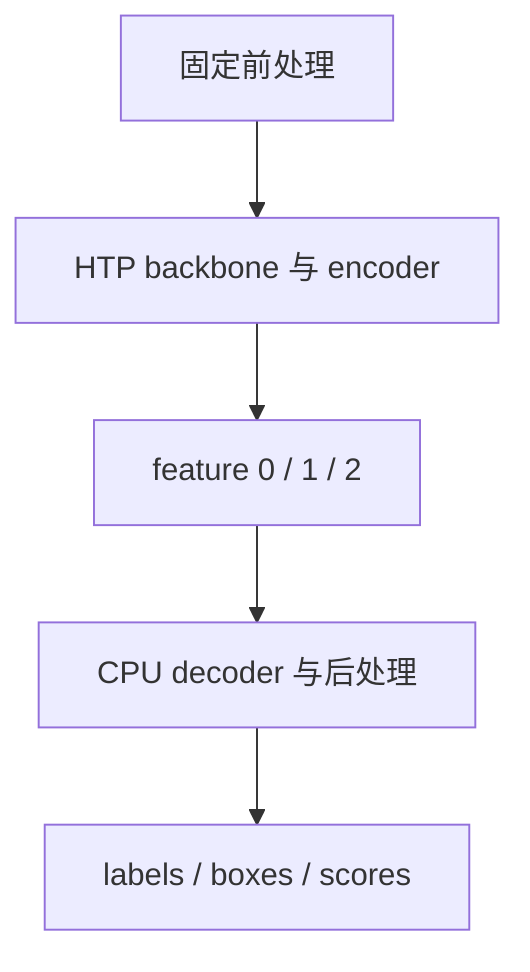

# Qualcomm HTP 上 DEIM 的数值误差与拆图

DEIMv2-S 在 QCS9075 上可以执行整图 HTP FP16，但检测结果与 CPU 明显偏离。真正需要定位的是误差来源与传播：单个张量余弦低，可能既包含本层误差，也包含上游输入漂移；某个算子有误差，也不意味着它决定最终任务失败。

归档组合为 HTP v73、QAIRT 2.50.40、ORT Core 1.30.0 与 QNN EP 2.6.0。最终采用 HTP backbone/encoder＋CPU decoder/postprocessor，context 固化后的整链延迟约 80 ms，保留了检测输出对齐。

# 一、正反向拆分

| 对照 | top-1 / scores | 能说明什么 |
| --- | --- | --- |
| CPU 整图 | top-1 0.9573 | 参考 |
| HTP 整图 | top-1 约 0.314 | 任务精度失效 |
| HTP encoder＋CPU decoder | top-1 0.9575；cos 0.999916 | 前段特征足够可用 |
| CPU 固定特征＋HTP decoder | top-1 0.3823 | 后段 HTP 路径存在问题 |
| CPU 拆图 | 与整图一致 | 拆分未改变数学语义 |

正反两组对照比只观察整图误差更有因果信息。输入尺寸元数据、前处理和后处理先校准，再开展拆图，避免把参考链路的错误混入硬件归因。

# 二、误差传播

同一真实特征输入下，decoder 的部分张量余弦如下：

| 位置 | 余弦 |
| --- | ---: |
| enc_score_head | 1.000000 |
| pre_bbox_head | 0.836427 |
| layer0 cross-attention | 0.969637 |
| layer0 norm3 | 0.717081 |
| layer1 / layer2 norm3 | 0.461559 / 0.149937 |
| 最后 bbox head | 0.031965 |

误差在 bbox、attention、归一化和迭代回归中传播。低余弦定位了敏感位置，但仍需使用固定输入的独立子图才能把误差归到该位置的具体 kernel。

真实输入探针中，Self-attention Softmax 的最大绝对误差约为“CPU 参考输出转 FP16”基线的 39.2 倍，RMSNorm 约为 3.5–5 倍。这个基线只表示最终输出舍入，不包含一次完整 FP16 计算的所有累积误差，因此不能直接用倍率推断闭源内核内部累加精度。

# 三、反证与回退核验

早期曾怀疑 GELU/Erf 是唯一主因。把其测得扰动注入 CPU 模型后，检测结果没有相应变化，因而应撤销这一结论。

另一些 op affinity 实验的结果突然完全对齐，profile 却显示大范围甚至整图 CPU 回退。Softmax 排除实验中约 7926 个节点全部由 CPU 执行，耗时约 403 ms；“结果正确”并没有证明仅目标算子回退。

# 四、显式交付边界

encoder 保存为 QNN EPContext，decoder 保存为 CPU ONNX，并用 manifest 描述同一接口。验收包括 CPU 拆图等价、HTP 禁止回退、context 重加载、真实输入整链比较和目标设备计时。单图结果用于回归，完整发布仍需验证集 AP。

# 五、一些反思

数值归因需要能够推翻自己的实验。固定输入、反向拆分、扰动注入和 provider trace 共同约束解释，比挑选一个误差最大的算子更可靠。

合理切图不是失败的退让，而是对误差与成本的明确控制。边界稳定、传输量适中且任务结果对齐时，显式异构执行比不可控的自动分区更容易维护。

# 六、参考资料

- [QNN Execution Provider](https://onnxruntime.ai/docs/execution-providers/QNN-ExecutionProvider.html)
- [EPContext 设计](https://onnxruntime.ai/docs/execution-providers/EP-Context-Design.html)
- [DEIMv2](https://github.com/Intellindust-AI-Lab/DEIMv2)

