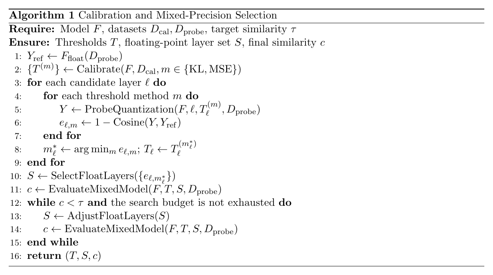

# Sophgo 校准与混合精度选择

将 YOLOv5 的 ONNX 编译到 BM1684X 时，TPU-MLIR 提供浮点、INT8 和混合精度路径。INT8 流程通过校准数据确定量化范围；混合精度则允许部分敏感层保留高精度。

操作时会同时接触 calibration table 与 qtable。前者决定“浮点数映射到整数时使用多大的范围”，后者决定“哪些层采用什么精度”。两张表都影响最终结果，但不能互相替代。

| 产物 | 控制内容 | 主要问题 |
| --- | --- | --- |
| 校准表 | 各张量的阈值与范围 | 截断和舍入之间怎样折中？ |
| 混合精度表 | 层或张量的精度选择 | 哪些量化误差值得用浮点代价换回？ |

# 一、阈值与输入分布

以简化的有符号对称 INT8 为例，取浮点范围 $[-T,T]$：

$$
s=\frac{T}{127},\qquad
q=\operatorname{clip}\left(\operatorname{round}(x/s),-127,127\right),\qquad
\hat{x}=sq
$$

$T$ 大，较少截断极值，但整数步长更粗；$T$ 小，常见值能够分得更细，却更容易截断离群值。KL、MSE 等校准方法用不同准则选择这个折中，同一种方法不必在每层或每种数据上都最优。

因此，校准前先对齐 RGB/BGR、resize/letterbox、padding、归一化和数据范围。如果校准阶段重复执行 `/255`，阈值搜索可能在自身数据上很好，却没有描述真实推理输入。

检测数据还需要覆盖目标大小、背景、光照和负样本。校准集的数量有用，但对部署分布的覆盖往往更值得先检查。

# 二、层敏感性与误差传播

一层的局部误差不等于它对最终结果的影响。在线性化理解下，某层扰动 $\delta h_\ell$ 对输出的影响近似为：

$$
\delta y\approx J_{\ell+1:L}\,\delta h_\ell
$$

$J_{\ell+1:L}$ 表示后续计算对该层状态的局部敏感性。这不是实际搜索所需的完整 Jacobian 计算，而是说明：后续结构可能放大或压低同样大小的扰动。

因此，只按单层 MSE 排序容易忽略任务敏感性。`search_qtable` 将候选阈值比较、层敏感性分析和完整混合模型验证串起来；下面给出默认 cosine 思路的概念流程。

算法中 $D_{\mathrm{cal}}$ 用于统计阈值，$D_{\mathrm{probe}}$ 用于搜索和输出比较；$S$ 为浮点层集合。ProbeQuantization 表示在受控候选精度配置下做对照，不代表每次都采用相同的全图量化组合。具体实现还包含候选筛选、搜索上限和提前退出。

校准阈值与精度选择存在联系：某层“敏感”，可能部分来自阈值不合适。先比较阈值，再决定是否付出浮点成本，通常比一遇到掉点就把层改回 F16 更有解释力。

# 三、输出相似度与任务精度

`expected_cos=0.99` 约束的是选定输入、输出和比较方式下的相似度。它不是检测 mAP 的保证，也不是穷举全部浮点层组合后得到的全局最优解。

检测模型存在阈值、排序和 NMS 等后处理：整体张量差异很小，仍可能改变少数临界框的保留结果。余弦适合搜索和定位，最终还要用实际框、类别、误检漏检和任务指标判断。

建议对 F16、全 INT8、混合 INT8 固定数据和运行条件，比较以下项目，而不是只保留一行 cosine：

| 维度 | 固定或记录内容 |
| --- | --- |
| 精度 | 同一评测集、前后处理、任务指标及关键场景误差 |
| 时延 | 同一输入大小、batch、预热与统计方式 |
| 精度配置 | 浮点层列表、校准表、工具版本 |
| 实际收益 | 端到端耗时、模型大小及必要的设备切换开销 |

搜索数据与最终评测数据应有明确分工。反复在同一小批图片上选择阈值和浮点层，可能只优化这批数据；独立验证集用于检查选择是否能够迁移。

# 四、一些反思

混合精度是一种有成本的恢复手段。浮点层越来越多时，应先回头检查校准分布、导出接口和比较指标；否则输出可能恢复了，量化带来的速度和空间收益却消失了。

更有价值的结论是解释“为什么这些层值得保留高精度”，并用最终任务指标与端到端成本支持选择。最少浮点层数、最高 cosine 和最低时延分别优化不同目标，不能默认它们总能同时达到。

校准表、qtable、数据划分和运行版本需要成组保留。只有这些条件一致，后续的精度变化才能被解释为一次具体修改的结果，而不是实验条件漂移。

# 五、参考资料

- [TPU-MLIR](https://github.com/sophgo/tpu-mlir)
- [校准参数与搜索入口](https://github.com/sophgo/tpu-mlir/blob/master/python/tools/run_calibration.py)
- [阈值与敏感层搜索实现](https://github.com/sophgo/tpu-mlir/blob/master/python/calibration/search_qtable.py)
