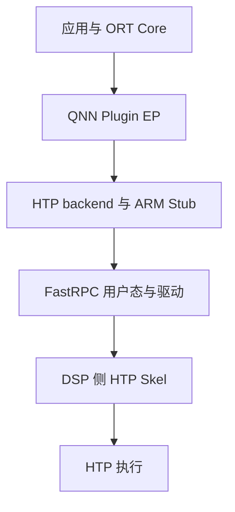

# Qualcomm QNN 环境部署与 ABI 排查

在高通 Linux 设备上通过 ONNX Runtime 使用 QNN HTP，需要同时准备 ORT、QNN EP、QAIRT 用户态运行库和设备侧 FastRPC 环境。库文件齐全只是第一步，还要确认应用实际加载的版本、插件注册方式，以及 ARM 与 DSP 两侧的通信是否正常。

本文按部署顺序检查这条链路，以 Linux ARM64、glibc 和独立 QNN Plugin EP 为主。命令中的 `/opt/qnn-runtime` 是示例目录，使用时替换为实际解压位置；Android 使用另一套系统库和工具链，不能直接复制这些 Linux 二进制。

# 一、确认系统与运行库组合

先在目标设备记录系统信息：

```bash
uname -m
cat /etc/os-release
getconf GNU_LIBC_VERSION
```

`aarch64` 只说明 CPU 指令集。Linux/glibc、Android/Bionic 和 Linux/musl 的用户态并不相同；选择 SDK 时还要核对系统类型、工具链目录和设备 BSP。开发机上的 x86_64 编译工具也不能作为 ARM64 运行库交付。

准备运行环境时，将应用侧文件和设备系统依赖分别列出：

| 部分 | 典型文件或组件 | 来源与职责 |
| --- | --- | --- |
| ORT Core | `libonnxruntime.so`、对应头文件 | 运行 Session、提供 EP 接口 |
| QNN Plugin EP | `libonnxruntime_providers_qnn.so` | 将 ORT 子图交给 QNN；文件名以实际发行包为准 |
| QAIRT 用户态 | `libQnnHtp.so`、所需 System 库、对应 HTP Stub | backend 与 ARM 侧调用接口 |
| DSP 执行库 | 对应架构的 HTP Skel | 来自配套 SDK 或设备运行环境，在 DSP 侧加载 |
| BSP 与系统服务 | FastRPC 用户态库、驱动、固件、设备节点和相关服务 | 提供设备访问与 ARM/DSP 通信 |

这里有两种不同的 ORT 集成方式。内置 legacy QNN EP 随带有 QNN 支持的 ORT 构建提供；独立 Plugin EP 则在运行时注册。先确定使用哪一种发行包，再选择初始化 API，不能只根据动态库文件名判断。

归档中通过独立模型测试的一组环境为 ORT Core 1.24.4、QNN Plugin EP 2.2.0、QAIRT 2.46.0。这是已验证组合的记录，不代表把三个组件分别升级到最新版也能直接运行。部署清单需要保存完整版本、包来源和目标设备信息。

# 二、检查 ELF 架构与符号需求

在 Linux 设备或具备对应 ELF 工具的构建环境中检查文件：

```bash
runtime_dir=/opt/qnn-runtime
file "$runtime_dir/lib/libonnxruntime.so"
file "$runtime_dir/lib/libonnxruntime_providers_qnn.so"
file "$runtime_dir/lib/libQnnHtp.so"

readelf -h "$runtime_dir/lib/libonnxruntime_providers_qnn.so"
readelf -d "$runtime_dir/lib/libonnxruntime_providers_qnn.so"
readelf -V "$runtime_dir/lib/libonnxruntime_providers_qnn.so"
```

`-h` 用于确认 ELF 位数和机器架构；`-d` 查看 `NEEDED`、`RPATH`、`RUNPATH` 等动态链接信息；`-V` 查看符号版本。对应用可执行文件还可以使用 `readelf -l ./qnn_probe` 检查解释器路径。共享库未必带有解释器段，不能据此认定文件损坏。

出现下面的错误时，已经不是简单的“没有找到文件”：

```text
version `GLIBC_2.xx' not found
version `GLIBCXX_3.4.xx' not found
undefined symbol: ...
```

`GLIBC_*` 对应 glibc 提供的版本化符号，`GLIBCXX_*` 通常对应 libstdc++。读取目标文件的 version needs，再与目标系统实际加载的提供库对照。只比较 GCC 版本或从 `strings` 输出中取一个最大版本号，不能证明整个依赖链兼容；应用、插件和 backend 的间接依赖也可能提出更高要求。

自编译应用时，优先使用设备配套 sysroot，或在与目标用户态一致的构建环境中编译。此前另一条高通部署链路采用固定 glibc 2.35 的工具链，并在构建阶段检查产物的符号需求；同样的方法可以用于 QNN 应用侧，减少到了板端才发现 ABI 不匹配的情况。QAIRT 的预编译库仍需单独核对，重新编译应用不能降低它的系统依赖。

遇到符号版本不满足，先更换匹配的发行包或重建自有组件。直接替换板端系统 libc 会影响整台设备，也无法解决 Plugin API、DSP 架构或 context 格式不匹配。

# 三、配置 ARM 与 DSP 两侧的加载路径

HTP 执行需要经过两侧运行环境：



`LD_LIBRARY_PATH` 影响 ARM 侧动态库搜索，`ADSP_LIBRARY_PATH` 用于 DSP 侧库搜索。下面是目录组织示例，`hexagon-vXX` 和系统 DSP 路径应按设备实际环境填写，不能原样照搬：

```bash
runtime_dir=/opt/qnn-runtime
export LD_LIBRARY_PATH="$runtime_dir/lib${LD_LIBRARY_PATH:+:$LD_LIBRARY_PATH}"
export ADSP_LIBRARY_PATH="$runtime_dir/dsp/hexagon-vXX/unsigned;/usr/lib/rfsa/adsp;/dsp"
```

两个变量的分隔方式不同。上面的 DSP 路径使用分号，整个值需要引号包围；还要确认当前平台的 SDK/BSP 对搜索路径的要求。不要为了“让加载器都能找到”而把 DSP Skel 目录混入 ARM 库搜索路径。

在目标设备的同一环境下检查宿主依赖：

```bash
ldd "$runtime_dir/lib/libonnxruntime_providers_qnn.so"
ldd "$runtime_dir/lib/libQnnHtp.so"
```

`not found` 表示当前解析不到对应依赖；若解析到了系统目录里的另一份同名库，也要继续核对版本。`ldd` 只覆盖动态依赖解析，运行中通过 `dlopen` 加载的 backend、Stub，以及 DSP 侧的 Skel，仍需通过实际初始化检查。

对正在运行的 Linux 进程，可以查看已映射文件：

```bash
process_id=1234  # 替换为目标进程 PID
rg 'libonnxruntime|libQnn|libcdsprpc|libstdc\+\+' "/proc/$process_id/maps"
```

这能发现 Python 环境、系统目录和应用目录中的库被混用。若程序在初始化阶段就退出，可对独立探针开启 glibc 加载日志：

```bash
LD_DEBUG=libs,versions ./qnn_probe 2>loader.log
```

`qnn_probe` 表示自行编写的最小 ORT 测试程序，不是 SDK 固定命令。日志中的搜索路径和最终加载文件，比安装目录中的文件列表更能说明问题。`RPATH/RUNPATH` 和环境变量都会影响搜索，不能仅凭设置了 `LD_LIBRARY_PATH` 就认为一定加载了指定版本。

systemd 服务与容器也需要显式传入环境。交互终端里设置的变量不会自动成为服务配置；容器拥有完整用户态库，也仍然依赖宿主的设备节点、权限、驱动和固件。

# 四、注册 Plugin EP 并选择设备

独立 Plugin EP 按下面的顺序初始化：

```text
创建 Ort::Env
    → RegisterExecutionProviderLibrary(name, plugin_path)
    → GetEpDevices()
    → 选择实际枚举到的 QNN EP 设备
    → SessionOptionsAppendExecutionProvider_V2(devices, options)
    → 创建 Session 并执行模型
释放 Session
    → 注销插件库
```

这是调用顺序，具体参数和设备名称访问方法以所用 ORT 头文件为准。应用编译使用的 API 与部署 Core 必须兼容；不能直接把另一版文档中的 C++ 示例复制进旧版适配层。

库注册名由应用指定，设备的 EP 名来自枚举结果，两者是不同概念。QNN 官方示例都使用 `QNNExecutionProvider`，保持一致便于排查，但不能据此认为所有插件都要求固定注册名。设备筛选应输出实际 EP 名、厂商和设备信息，不能用适配层自己的 `QNN`、`qcom` 简称代替枚举结果。

每个阶段至少保留以下信息：

| 阶段 | 应记录的内容 |
| --- | --- |
| 加载与注册 | ORT Core 完整版本、插件绝对路径、注册名、原始错误 |
| 设备发现 | 设备数量、各设备 EP 名与设备信息 |
| Session 配置 | 选中的设备、backend 路径、关键 EP 选项 |
| 图构建与执行 | 第一个失败阶段、原始错误、节点分配与输出检查 |

归档排查中，独立探针在前述 1.24.4 / 2.2.0 / 2.46.0 组合下能够创建 Session 并运行模型，应用却返回：

```text
QNN execution provider is not supported in this build
```

应用未选到 QNN 设备后，回退调用了 legacy 的 `AppendExecutionProvider("QNN", ...)`。当前 Core 没有内置 legacy QNN EP，最终异常覆盖了前面的设备发现问题。修改时去掉这条回退，在设备选择失败处直接保留注册状态和枚举结果，再使用 Plugin EP 的 V2 路径初始化。

这个错误没有证明模型算子不受支持，因此不需要先重新导出或量化模型。若应用需要兼容两种 ORT 发行方式，应明确配置集成方式，分别初始化；不能把 Plugin EP 初始化失败当作切换到 legacy API 的依据。

`Ort::Env` 和已注册插件的生命周期需要覆盖相关 Session。释放所有使用该插件的会话后，再注销库。

# 五、验证设备通信与最小模型

如果插件可加载，但 HTP 初始化失败，先检查设备通信。设备提供对应 QAIRT 工具时，可以在配置好库路径的同一终端运行：

```bash
qnn-platform-validator --backend dsp
```

工具是否包含该参数，以随包帮助信息为准。还需按板卡 BSP 检查 FastRPC 设备节点、CDSP 服务或 listener、DSP 固件和权限；不同 Linux BSP 的节点名与服务名并不完全相同，不应把另一块板的安装命令直接套用。

transport 探针成功，只说明对应通信测试通过。接下来用独立 ORT 小模型测试完整路径：选择已知受当前 backend 支持的静态图，固定输入，将应用和模型本身的复杂性降到最低。测试 HTP 子图时关闭 CPU EP fallback：

```cpp
session_options.AddConfigEntry("session.disable_cpu_ep_fallback", "1");
```

同时检查日志或 profile 中的节点分配，再验证输出形状、数值和重复运行结果。设备列表包含 QNN，或者 Session 创建成功，都不能单独证明目标计算已经在 HTP 上正确完成。

如果正式模型采用 HTP encoder 与 CPU decoder 的显式拆分，分别验证两个 Session；禁用 fallback 用于检查预期放到 HTP 的那段图，不能误用于否定设计中保留的 CPU 段。具体拆图与精度处理见 [Qualcomm HTP 上 DEIM 的数值误差与拆图](../quantization-accuracy/Qualcomm_DEIM精度归因.md)。

| 首个失败位置 | 优先检查 |
| --- | --- |
| ELF 或插件库加载 | CPU 架构、libc 类型、符号需求、实际库路径 |
| 插件注册或设备发现 | Core/Plugin API、发行包组合、枚举与选择逻辑 |
| HTP 初始化或 transport | Stub/Skel 架构、FastRPC、设备权限、BSP 环境 |
| 图构建或 finalize | 算子、shape、dtype、backend 能力与编译配置 |
| context 加载 | 生成端与运行端版本、目标设备、外部文件完整性 |
| Run 或输出检查 | 执行日志、输入输出契约、数值与任务精度 |

这些是缩小范围的入口，不是错误码与根因的一一映射。加载依赖的问题也可能延迟到图构建阶段才暴露，仍需保留最早的底层日志。

# 六、生成并重新加载 EPContext

不同模型文件需要的运行条件并不相同：

| 格式 | 包含什么 | 仍需验证什么 |
| --- | --- | --- |
| 普通 ONNX | 图与权重 | backend 对算子、shape、dtype 的支持 |
| QDQ ONNX | 图、权重与量化参数 | 位宽、量化模式与实际 kernel 支持 |
| EPContext ONNX | QNN context 引用或内嵌内容 | context 与运行库、设备环境的兼容性 |

归档中较新的运行组合已能执行浮点 HTP 图。是否需要 QDQ，要按 SoC、QAIRT 和 EP 的实际支持判断，不能沿用“HTP 一律只能运行量化图”的旧结论。

使用所选 QNN EP 版本支持的 context 生成方式后，另起一个进程加载生成产物，用相同输入比较结果。这样才能发现外部文件遗漏、路径依赖或运行环境不匹配。首次 Session 创建并成功写出 context，只完成了生成阶段。

external 模式需要将 wrapper ONNX 与它引用的 binary 一起交付，保留引用关系；embed 模式将 context 放进 ONNX，减少外部文件，但仍然需要 QNN EP、backend 和设备侧环境。包含 QNN EPContext 的模型不能交给纯 CPU EP 当作原始 ONNX 图执行。

记录生成时的 SoC、HTP 架构、QAIRT 版本和编译选项，并以官方兼容说明及目标设备重载结果判断能否复用。出现 `Using newer context binary on old SDK` 一类提示时，应核对生成端与运行端的兼容范围，再选择匹配 runtime 或重新生成产物；修改文件名不会改变 context 格式。

# 七、整理部署包与验证记录

部署目录可以按下面的方式组织，具体所需库由实际发行包决定：

```text
qnn-runtime/
├── bin/                 # 应用与独立探针
├── lib/                 # ARM64 ORT、Plugin、QAIRT 用户态库
├── dsp/                 # 配套 HTP Skel，保留架构信息
├── models/              # ONNX、context 及必要的外部文件
└── manifest.json        # 版本、目标环境、文件哈希与验证结果
```

manifest 至少记录 ORT、Plugin、QAIRT 版本，系统与 glibc 信息，SoC/HTP 架构，BSP/固件版本，以及模型、context 和关键运行库的 SHA-256。发布包只能包含许可允许分发的组件，BSP 驱动、固件和系统服务作为设备前置条件另行记录。

最后在实际服务启动环境中重跑独立探针和正式模型。升级某一层后，保留参考输入，依次检查加载、注册、设备通信、图执行与 context 重载；不要同时替换模型、SDK 和 BSP 后只记录一个最终错误。将每一步的日志与输出基线保存下来，下一次更换模型时就能复用已经确认的环境。

# 八、参考资料

- [QNN Plugin EP：配置、模型支持与官方用法](https://github.com/onnxruntime/onnxruntime-qnn/blob/main/docs/execution_providers/QNN-ExecutionProvider.md)
- [ONNX Runtime Plugin EP 注册与设备选择](https://onnxruntime.ai/docs/execution-providers/plugin-ep-libraries/usage.html)
- [EPContext 设计与文件组织](https://onnxruntime.ai/docs/execution-providers/EP-Context-Design.html)
- [GNU readelf：ELF 与符号版本检查](https://sourceware.org/binutils/docs/binutils/readelf.html)
- [Linux 动态链接器：搜索路径与加载诊断](https://man7.org/linux/man-pages/man8/ld.so.8.html)
